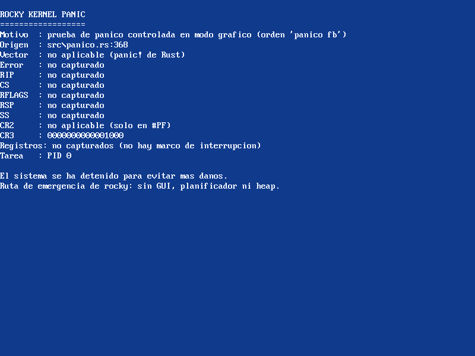
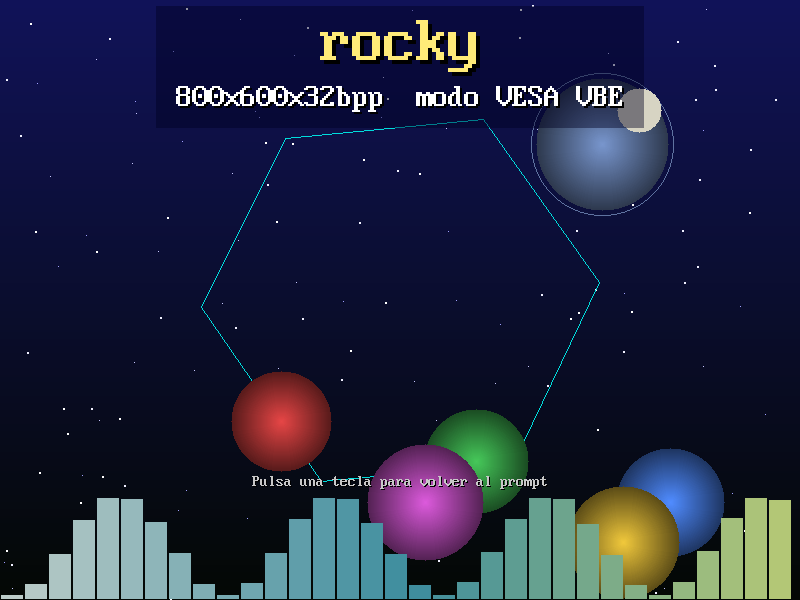
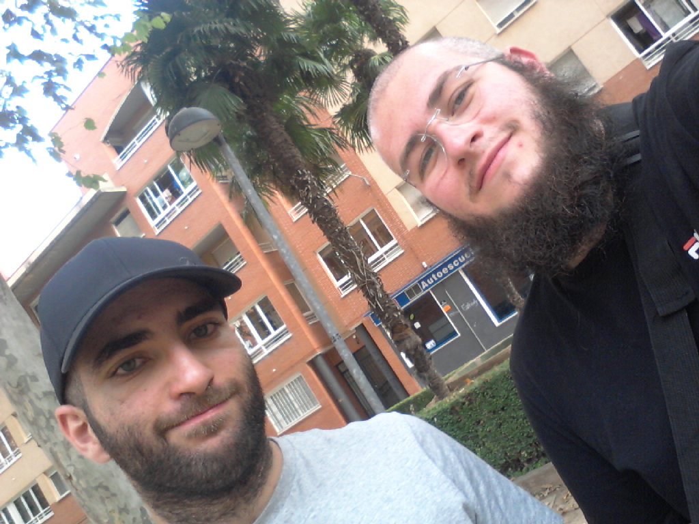

# Rocky & Toby OS — un sistema operativo x86_64 escrito 100% en Rust

[](LICENSE)

**rocky** (tambien llamado **Rocky & Toby OS**) es un sistema operativo arrancable, escrito integramente en Rust, que
corre en modo largo (x86_64) sobre un PC BIOS. No esta basado en Linux ni en
ningun otro sistema: **el diseño es propio**. Es un sistema **monousuario y
multitarea** con:

- su propio gestor de **memoria fisica** (marcos de 4 KiB) y un **heap** con
  paginacion dinamica;
- su propio sistema de ficheros, **Estrato**, sobre un **disco ATA** de verdad,
  de modo que lo que escribes se conserva al apagar;
- un interprete de ordenes cuyos nombres siguen el **estilo de Linux**
  (`ls`, `cd`, `cat`, `mkdir`, `rm`, `cp`, `mv`, ...) y rutas con `/`;
- un **lenguaje de programacion** propio y su maquina virtual, con ejecutables
  **`.rok`** (el equivalente a los `.exe` de Windows): se escriben con `asm` y se
  ejecutan con `run`.

```
  rocky  -  sistema de ficheros Estrato
  (un nucleo x86_64 en modo largo, escrito 100% en Rust)

  volumen "ESTRATO": 32768 KiB, 65384 bloques libres
  escribe 'help' para ver las ordenes.

root@rocky:/ $ ls
home/               bienvenida          inicio
root@rocky:/ $ cd /home/escritorio
root@rocky:/home/escritorio $ run hola.rka
Como te llamas? Rocky
Hola, Rocky! Bienvenido a rocky.
root@rocky:/home/escritorio $ asm hola.rka
asm: hola.rka -> hola.rok (44 bytes de codigo, 3 textos)
root@rocky:/home/escritorio $ run hola.rok
Como te llamas? Ana
Hola, Ana! Bienvenido a rocky.
```

Al formatear, el volumen queda asi: en la raiz `/` viven los ficheros de sistema
(**`bienvenida`** e **`inicio`**) junto a la carpeta de usuario **`/home`**, con
**`/home/escritorio`** como carpeta de trabajo. En ella se deja un programa de
ejemplo: `hola.rka`.

## Instalacion en un PC real

Las imagenes arrancables se publican en la pagina de
[Releases](https://github.com/rdr-retro/rocky-toby-os/releases/latest) del
repositorio; no se versionan en git por su tamano.

1. Descarga `rocky-usb.img` de la ultima release.
2. Graba un pendrive con [balenaEtcher](https://etcher.balena.io/):
   **Flash from file** -> `rocky-usb.img`, **Select target** -> el pendrive y
   **Flash!**. Etcher escribe la imagen byte a byte y la verifica al terminar;
   no hace falta formatear el pendrive antes (se borra entero).
3. Arranca el PC desde el pendrive. El arranque es **BIOS legacy (MBR)**: elige
   el USB en el menu de arranque y, si el equipo tiene Secure Boot, desactivalo.
4. Requisitos: CPU **x86_64 con PAE** (Intel 64 / AMD64). Los Core Solo y
   Core Duo "Yonah" de 2006 son de 32 bits y no pueden ejecutar el kernel: el
   arranque lo detecta y muestra un aviso por pantalla en vez de reiniciarse.

`rockydisk.img` es el volumen Estrato de datos y **no se graba con Etcher**: se
usa como segundo disco en QEMU o para una maquina virtual. El pendrive
`rocky-usb.img` ya lleva el sistema completo.

## Estado

El kernel **arranca de verdad** en QEMU (BIOS), configura modo largo (x86_64),
IDT, PIC, temporizador y puerto serie, inicializa memoria y disco, monta (o
formatea) el volumen **Estrato** y arranca con el **servidor de ventanas Kira
activo** (fase 12): su compositor toma el framebuffer y deja un **escritorio
vacio** —fondo azul y el cursor del raton, **sin texto encima**—; `ESC` devuelve
la consola de texto (el servicio `kira` sigue activo, solo se oculta su pantalla)
y los clientes de
anillo 3 se conectan por `/dev/kira` y hablan el protocolo Kira (compatible con
el nucleo de X11). El escritorio se puede poner a **cualquier resolucion** con la
orden **`gui [WxH]`** (p.ej. `gui 1920x1080`): el modo lo pone el **driver AMD**
y solo si no puede se recurre a los modos VESA de la BIOS, con cascada de
respaldo si no existe ninguno (fase 14c) y el **cursor del raton se mueve
fluido** (raton a 200 Hz y compositor que no duerme mientras se mueve). Es
**multitarea**: los servicios de fondo y los procesos de anillo 3 corren en sus
propias tareas. Tambien reproduce **sonido** por el altavoz interno,
saca **graficos 2D** en varias resoluciones VESA VBE con una demo animada,
**muestra imagenes PNG** a pantalla completa (orden `imagen`) y
ejecuta **aplicaciones del lenguaje `.toby`** (orden `toby`), cuyos **botones son
PNG** del kit AQUA ensamblados en tres piezas. Ademas del
nucleo, sabe ejecutar **programas de usuario en anillo 3** con su propio espacio
de direcciones y las llamadas al sistema de Linux 0.01: **`fork`**, **`wait4`**,
**`execve`** (reemplazo de la imagen con un ejecutable del disco), la capa de
**descriptores de fichero** (**`open`**, **`read`**, **`close`**, **`lseek`**,
**`dup`**/**`dup2`**), la **memoria virtual bajo demanda** con **`brk`** y
**copia-al-escribir** (`fork` ya no copia: padre e hijo comparten las paginas en
solo lectura hasta que uno escribe), las **tuberias anonimas** (**`pipe`**),
donde un lector se duerme hasta que llegan datos o se cierra el ultimo escritor
(entonces la lectura da fin de tuberia), las **senales** (`rt_sigaction`,
`rt_sigprocmask`, `rt_sigreturn`, `pause`, `alarm`, `kill`; de `kernel/signal.c`),
que se entregan al volver a anillo 3, y un **terminal** propio (`kernel/tty_io.c`):
la consola tiene su `termios` (modo canonico con eco y edicion), se controla con
`ioctl` (`TCGETS`/`TCSETS`, grupo en primer plano, tamano) y se estrena sesion con
`setsid`. Cada proceso tiene ademas su **directorio de trabajo** propio
(`chdir`/`getcwd`, de `fs/open.c`), desde el que resuelve las rutas relativas de
`open` y `execve`, y el **filesystem completo** queda al alcance de un programa
de usuario con las llamadas de Linux: `stat`/`fstat`/`lstat`, `access`,
`getdents64`, `mkdir`/`rmdir`, `rename`, `link`/`unlink` y `sync` (de
`fs/namei.c`, `fs/stat.c`, `fs/readdir.c` y `fs/open.c`). Ademas, al arrancar
**barre el bus PCI** y localiza la tarjeta grafica (fase 13), consultable con las
ordenes `lspci` y `gpu`; si es AMD, le abre la **ventana de registros** y ya puede
**leerla y escribirla**, con el **cursor por hardware** como primer uso (fase 14).
Ademas del volumen Estrato, deja una **particion FAT32 propia (`0x0C`) con los
comandos ejecutados en `COMANDOS.LOG`**, con tabla de particiones (MBR) hecha
por el constructor, para **leer la sesion desde Windows sin OCR**.
Si algo falla de
forma irrecuperable, un
**subsistema de emergencia** propio toma el control y muestra una **pantalla azul**
con el diagnostico (vector, codigo de error, `RIP`, `CR2`...) sin depender del
servidor de video, del planificador ni del heap, y detiene la maquina. Verificado
con QEMU 11.1.0.

## Requisitos

- Rust (probado con 1.99) con el objetivo `x86_64-unknown-none`:
  ```
  rustup target add x86_64-unknown-none
  rustup component add llvm-tools-preview
  ```
- QEMU (`qemu-system-x86_64`) para ejecutarlo.

No se necesita `gcc`, `nasm`, `objcopy` ni `make`: todo lo construye el propio
proyecto con `rustc` + `rust-lld` + `llvm-objcopy`.

## Como construir y ejecutar

```powershell
# Construir la imagen de arranque (rocky.img) y el disco (rockydisk.img)
cargo run --manifest-path xtask/Cargo.toml -- build

# Arrancar en una ventana de QEMU (consola VGA)
cargo run --manifest-path xtask/Cargo.toml -- run

# Arrancar en modo desatendido (VGA + salida por puerto serie en la terminal)
cargo run --manifest-path xtask/Cargo.toml -- run-serial

# Windows: acelerar la ejecucion de la CPU invitada con WHPX
cargo run --manifest-path xtask/Cargo.toml -- run-whpx
```

`run-whpx` requiere tener habilitada la caracteristica **Windows Hypervisor
Platform**. WHPX acelera la CPU virtual, no el renderizado de la GPU: QEMU sigue
presentando una VGA `std` emulada y Kira sigue dibujando por CPU. Para acelerar
graficos dentro de QEMU falta un driver VirtIO-GPU en rocky; `virtio-vga-gl`
por si solo no acelera el kernel. La RX 550 real tampoco ejecuta aun las colas
SDMA/GFX: el soporte actual llega a deteccion, modosetting/cursor en hardware y
optimizacion de escrituras CPU al framebuffer. Ademas, WHPX puede no mejorar
mucho el modo grafico VGA/VBE antiguo que usa rocky.

O con los scripts de conveniencia: `.\build.ps1`, `.\run.ps1`. En Windows,
`run.ps1` usa `run-whpx` para acelerar la ejecucion del invitado durante el
desarrollo; `run-serial` conserva el modo de compatibilidad sin WHPX.

Para la comprobacion completa, `.\verif-todo.ps1` lanza **todos** los
`verif-*.ps1` (cada uno arranca QEMU por su cuenta) y resume al final:

```powershell
powershell -ExecutionPolicy Bypass -File .\verif-todo.ps1
```

El arranque usa un **disquete** de 1.44 MB (`rocky.img`) que contiene el
sistema; los ficheros viven en un **disco duro virtual** (`rockydisk.img`,
97 MiB: 32 MiB de Estrato y 64 MiB de particion de logs FAT32) que el propio
rocky formatea la primera vez. La primera vez que se arranca solo
hay que aceptar el formateo automatico. El disquete tambien puedes abrirlo en
**VirtualBox, VMware o Hyper-V** como unidad de disquete, junto con un disco IDE.

### Arrancar en un PC real (pendrive)

El mismo `build` genera `rocky-usb.img`, la imagen en crudo de un **pendrive
arrancable**: un MBR de BIOS que carga el kernel y lleva dentro (detras de la
particion ESP) una copia del volumen Estrato. Se escribe en crudo con
`.\rocky-usb.ps1 -Disco N` (o con `formatear usb y copiar sistema.bat`, que usa el
disco 1). Al arrancarlo en un PC de verdad:

- **Arranque**: hay que activar **CSM / Legacy Boot** en la UEFI y desactivar
  **Secure Boot**. El MBR de BIOS carga el kernel, y este lee el volumen por las
  llamadas LBA del BIOS (`INT 13h`, `AH=42h`/`43h`): **no hace falta driver de
  disco**. (En UEFI puro sin CSM el MBR no arranca todavia; ver mas abajo.)
- **Video**: en las **Polaris** el modo lo pone el **propio kernel**, hablando
  con el bloque DCE de la GPU (fase 14c; ver *Modosetting real por el driver
  AMD*); en las demas tarjetas se pide un modo **VESA VBE** al firmware
  (`INT 10h` desde el trampolin de `bios.s`). Si el VBIOS de la
  tarjeta conserva el soporte VBE —las Polaris RX 4xx/5xx lo traen; algunas RDNA
  tambien, otras ya no—, Kira pone su escritorio azul a 1024x768. Si no lo trae,
  `reanudar()` se queda sin modo y **rocky sigue en modo texto** (la orden `modes`
  lo delata: lista vacia o incompleta).
- **Entrada**: la entrada base es **PS/2** (teclado y raton del 8042), pero un
  controlador **xHCI** con teclado/raton **USB HID** tambien funciona (ver
  *Teclado y raton USB*), incluso detras de un **hub USB 2.0**. Lo que falta es
  el resto de controladores USB (EHCI/UHCI/OHCI). Un teclado o raton USB
  pinchado en una maquina sin xHCI sigue sin verse.
- **Pendiente (fase futura)**: el arranque **UEFI + GOP** daria resolucion nativa
  en cualquier GPU sin driver, pero obliga a sustituir tambien el acceso a disco
  (hoy va por `INT 13h`, que en UEFI no existe) por *EFI Block I/O* o AHCI.

El volumen Estrato del pendrive es el que va dentro de la imagen: en el primer
arranque rocky lo formatea (o lo monta si ya estaba formateado).

Al arrancar, el kernel imprime un resumen del **bus PCI**; en un PC con tarjeta
AMD, su driver abre la ventana de registros y la orden `gpu` muestra el modelo,
sus BAR y el estado del bloque de pantalla, mientras que `cursor` prueba el
**cursor por hardware**. Con la ventana abierta, el driver tambien pone el modo
de video el mismo: en un PC con una Polaris, `gui 1920x1080` o `gui 320x240` no
pasan por el VBE, y en la consola de serie se ve por que candidato (encoder y
PLL) acabo cada modo (ver *Bus PCI y deteccion de la GPU*, *Ventana de registros
del GPU*, *Modosetting real por el driver AMD* y *Cursor por hardware*).

## Arquitectura

```
boot/        Sector de arranque BIOS (512 bytes) + trampolin a modo largo
  src/boot.s   - carga el kernel (INT 13h), A20, GDT, paginacion, long mode

kernel/      El nucleo de rocky (Rust, no_std/no_main)
  kernel.ld        script de enlazado (incluye la seccion .lowtext)
  src/main.rs      punto de entrada rust_main
  src/start.s      _start -> rust_main
  src/interrupts.s stubs de excepciones/IRQ
  src/idt.rs       IDT y despacho de excepciones y IRQ
  src/panico.rs    subsistema de emergencia: diagnostico y pantalla azul
  src/pantalla.rs  salida cruda de la pantalla azul (framebuffer VESA o texto VGA)
  src/pic.rs       PIC 8259A (IRQ0 temporizador, IRQ4 serie)
  src/pit.rs       temporizador a 100 Hz
  src/serial.rs    UART 16550 (COM1) con interrupcion de recepcion
  src/vga.rs       consola de texto VGA 80x25
  src/input.rs     teclado PS/2 + puerto serie (bufer circular)
  src/cmos.rs      RTC (fecha y hora)
  src/pmm.rs       gestor de memoria fisica (mapa E820, marcos de 4 KiB y refs)
  src/paging.rs    paginacion de 4 niveles y ventana del heap
  src/gdt.rs       segmentos de usuario (anillo 3) y TSS (sobre la GDT de bios.s)
  src/proceso.rs   procesos: espacio propio, memoria virtual (demanda/COW) y programas
  src/syscall.rs   llamadas al sistema (puerta `int 0x80` del anillo 3)
  src/fd.rs        descriptores de fichero (open/read/close/dup, tabla global)
  src/pipe.rs      tuberias anonimas (bufer circular, bloqueo y fin de tuberia)
  src/heap.rs      heap del kernel (asignador global, listas de huecos)
  src/disk.rs      ATA (PIO) + INT 13h: sectores, MBR y particiones
  src/fs.rs        sistema de ficheros Estrato
  src/fat32.rs     escritor de logs en la particion FAT32 (COMANDOS.LOG)
  src/visor.rs     visor de PNG a pantalla completa (orden `imagen`)
  src/shell.rs     interprete de ordenes de rocky
  src/servicios.rs servicios (estado active/inactive) y el estado del reloj
  src/rok.rs       formato del ejecutable .rok
  src/asm.rs       ensamblador del lenguaje de rocky (.rka -> .rok)
  src/vm.rs        maquina virtual y API de los programas .rok
  src/sound.rs     altavoz interno (PIT canal 2 + puerta 0x61)
  src/bios.rs      puente a la BIOS: INT 10h, VESA VBE y fuente de la VGA
  src/bios.s       trampolin modo largo -> modo real -> modo largo (.lowtext)
  src/acpi.rs      tablas ACPI: localiza PM1_CNT y el SLP_TYP de S5 para apagar
  src/gfx.rs       modos VESA y lienzo 2D (pixel, linea, rect, circulo, texto)
  src/demo.rs      demo grafica 2D (estrellas, esferas, poligono, espectro)
  src/pci.rs       bus PCI: enumeracion, BARs y catalogo de nombres (fase 13)
  src/drivers/     controladores por clase y fabricante (fase 14)
    mod.rs         punto de entrada: arranca las clases que haya
    gpu/mod.rs     clase de video: despacha entre fabricantes
    gpu/amd.rs     GPU AMD: ventana de registros (14), cursor por hardware (14b)
                   y modosetting real (14c)
    gpu/atom.rs    interprete de las tablas ATOMBIOS de la VBIOS (fase 14c)
    gpu/intel.rs   GPU Intel: hueco reservado, aun sin controlador
  src/ps2.rs       controlador 8042: prepara teclado y raton PS/2 (relojes, IRQ)
  src/mouse.rs     raton PS/2 por sondeo (puerto auxiliar del controlador 8042)
  src/tty.rs       terminal de la consola: termios, disciplina de linea e ioctl
  src/kira/        Kira Window Server: servidor de ventanas en el kernel (fase 12)
    mod.rs         estado global: conexiones, ventana raiz y pantalla
    dev.rs         dispositivo /dev/kira: handshake, setup reply y read/write
    req.rs         despacho de requests (CreateWindow, MapWindow)
    event.rs       generacion de eventos (Expose)
    conn.rs        estado por conexion (endian, cola de eventos, recursos)
    wm.rs          ventanas de Kira (arbol, geometria, mapeo)
    proto.rs       helpers de byte-order del protocolo Kira wire
    input.rs       cola de entrada (teclado/raton) por conexion
    comp.rs        compositor: fondo azul y cursor (servicio)
  src/tarea.rs     planificador multitarea (tareas ring 0 y procesos ring 3)
  src/cursor.rs    puntero del raton, superpuesto al framebuffer
  src/libraries/   librerias propias reutilizables (crates no_std: core + alloc)
    inflate/       descompresion DEFLATE (RFC 1951) y zlib (RFC 1950)
    png/           lector de imagenes PNG (RGB/RGBA/gris/paleta), usa `inflate`

xtask/       Constructor (compila, monta la imagen y el disco, lanza QEMU)
  src/fat32.rs   formatea la particion FAT32 de logs y crea COMANDOS.LOG
  src/ext4.rs    (solo para pruebas: crea un volumen EXT4 a medida)
docs/        Capturas de pantalla
```

### Arranque

1. La BIOS carga el **sector de arranque** en `0x7C00` y lo ejecuta en modo
   real de 16 bits.
2. `boot.s` habilita A20, lee hasta 512 KiB del kernel desde el disquete (LBA 1
   en adelante) al buffer bajo `0x10000..0x90000` y construye una GDT plana.
3. Activa modo protegido (32 bits), crea tablas de paginas con paginas de 2 MiB,
   habilita **PAE + paging** y salta a **modo largo** (64 bits).
4. El trampolin copia la imagen a `0x100000` y salta a `_start`, que llama a
   `rust_main`.

### Memoria (propia)

`pmm.rs` pregunta el mapa de memoria a la BIOS (**INT 15h EAX=E820**) y construye
un **mapa de bits de marcos de 4 KiB**. `paging.rs` maneja la paginacion de 4
niveles y reserva una **ventana** en la mitad alta (`0xFFFF_8000_0000_0000`) que
se va mapeando bajo demanda. `heap.rs` es el asignador global del kernel: una
lista de huecos ordenada, con fusion de huecos contiguos, que pide mas ventana al
gestor de marcos cuando hace falta. `Vec`, `String` y demas tipos de `alloc`
funcionan sobre este heap.

### Multitarea (propia)

`tarea.rs` da a rocky **tareas preemptivas** en el anillo 0. El reloj (IRQ0, a
100 Hz) llama al planificador en cada tic y este puede devolver el marco de
**otra** tarea; `interrupts.s` solo tiene que reajustar `rsp` con lo que
devuelva (`mov rsp, rax`). Cada tarea lleva su propia pila de 64 KiB y su
contexto va en el marco de interrupcion de cinco palabras (`rip, cs, rflags,
rsp, ss`).

- El **interprete de ordenes** es la tarea 0; cada **servicio** de fondo y cada
  **proceso de anillo 3** corre en su **propia tarea**.
- **Secciones criticas**: dentro de `tarea::critica` el planificador **no cambia
  de tarea**. Es mas fino que apagar las interrupciones (el reloj y los demas
  dispositivos siguen vivos) y basta porque solo hay una CPU: quien toca una
  estructura compartida (la lista de tareas, por ejemplo) no se la encuentra
  cambiada a mitad.
- Un programa puede **dormir** (`msleep`), con lo que deja correr a las demas sin
  gastar CPU, y **ceder** el turno explicitamente (`int 0x30`).
- La orden **`ps`** (o `tareas`) lista las tareas con su estado.

Todo comparte el mismo anillo y el mismo espacio de direcciones: hay multitarea,
pero **aun no hay aislamiento** entre tareas (el camino a ring 3 esta previsto).

### Procesos en anillo 3 (frontera usuario/nucleo)

Este es el primer paso hacia el modelo de Linux 0.01: ademas de las tareas del
nucleo (anillo 0, espacio compartido), rocky ya sabe ejecutar **programas de
usuario en anillo 3** con su **propio espacio de direcciones**, que solo pueden
salir de su caja pidiendo **llamadas al sistema** por `int 0x80`.

- La **GDT unificada** (la de `bios.s`, que el kernel necesita para hablar con el
  BIOS) gana los segmentos de usuario `0x38`/`0x40` (DPL 3) y un **TSS** `0x48`
  ([`gdt.rs`](kernel/src/gdt.rs)). El TSS da al procesador la **pila de anillo 0**
  (`RSP0`) que debe cargar al entrar por una interrupcion estando en anillo 3;
  el planificador la reajusta a la pila de nucleo de la tarea en curso.
- La **IDT** abre una puerta **accesible desde el anillo 3** (`DPL = 3`,
  `type_attr = 0xEE`) para el vector `0x80` ([`idt.rs`](kernel/src/idt.rs)).
- Cada proceso tiene su **propia PML4** ([`proceso.rs`](kernel/src/proceso.rs)):
  copia las entradas del nucleo (la identidad de la memoria baja y la ventana del
  heap) y anade una **ventana de usuario** a 512 GiB (PML4[1]) con paginas de
  4 KiB marcadas `U/S = 1`. Todo lo demas queda `U/S = 0`, de modo que en anillo 3
  **solo se puede tocar la ventana propia**: el aislamiento es real. El
  planificador cambia de CR3 al conmutar a un proceso.
- Las llamadas al sistema ([`syscall.rs`](kernel/src/syscall.rs)) usan la
  convencion de x86_64 (`rax` = numero, `rdi`/`rsi`/`rdx` = argumentos) y toman
  los numeros de Linux x86_64: `read` (0), `write` (1), `open` (2), `close` (3),
  `stat` (4), `fstat` (5), `lstat` (6), `lseek` (8), `access` (21),
  `rt_sigaction` (13), `rt_sigprocmask` (14), `rt_sigreturn` (15), `ioctl` (16),
  `pipe` (22), `dup` (32), `dup2` (33), `pause` (34), `alarm` (37), `getpid`
  (39), `brk` (12), `rename` (82), `mkdir` (83), `rmdir` (84), `link` (86),
  `unlink` (87), `getcwd` (79), `chdir` (80), `fork` (57), `execve` (59), `exit`
  (60), `wait4` (61), `kill` (62), `setsid` (112), `sync` (162) y `getdents64`
  (217) — 35 en total. Los punteros de
  `read`/`write`/`execve` tienen
  que caer dentro de la ventana del proceso. `exit` marca la tarea como muerta y
  cede el turno, con lo que el proceso nunca vuelve a su codigo.
- La orden **`usuario`** (o `anillo3`) lanza un programa de ejemplo en anillo 3 que
  imprime un saludo con `write` y termina con `exit`:

  ```
  root@rocky:/ $ usuario
  usuario: proceso en anillo 3 lanzado (PID 2).
  root@rocky:/ $ rocky: hola desde el anillo 3 (programa de usuario).
  ```

- Al morir, el proceso libera su PML4, sus tablas y sus paginas (planificador
  aparte, `tarea.rs` recoge la tarea y `Proceso` suelta los marcos).

### Procesos: fork/waitpid y execve (fases 2 y 3)

Sobre esa frontera, rocky ya tiene los tres verbos basicos de la gestion de
procesos de Linux 0.01, portados a Rust:

- **`fork` (57)**: [`tarea::bifurcar`](kernel/src/tarea.rs) duplica el proceso en
  curso. [`Proceso::clonar`](kernel/src/proceso.rs) **no copia nada**: comparte la
  ventana del padre marcando sus paginas de solo lectura y **copia-al-escribir**
  (ver *Memoria virtual bajo demanda*), de modo que el hijo ve las mismas
  direcciones virtuales sobre la misma memoria hasta que uno de los dos escribe.
  El
  marco de `int 0x80` del padre se copia al hijo con `rax = 0`, que es lo que
  distingue al hijo (`fork` devuelve 0) del padre (devuelve el PID del hijo).
  La orden **`fork`** lo prueba con un padre que se bifurca, espera y sigue.

- **`wait4` (61)**: [`tarea::esperar`](kernel/src/tarea.rs) bloquea al padre
  (`Estado::Durmiendo`) hasta que un hijo termina. Un proceso que acaba con
  `exit` y **tiene padre** queda **zombi** (`Estado::Zombi`) hasta que el padre
  lo recoge; entonces se le entrega el PID y el codigo de salida. El recolector
  libera los zombis huerfanos y los programas del nucleo terminados.

- **`execve` (59)**: [`syscall::ejecutar`](kernel/src/syscall.rs) lee la ruta del
  ejecutable de la ventana del proceso, lo **abre por la capa de descriptores**
  (Fase 4) y pide a
  [`tarea::ejecutar`](kernel/src/tarea.rs) que **reemplace la imagen** del
  proceso en curso. [`Proceso::ejecutar`](kernel/src/proceso.rs) libera las
  paginas de usuario viejas y monta el ejecutable nuevo, **conservando la PML4**
  (y por tanto la CR3 que ya esta cargada). No se pierde la identidad del
  proceso: `id`, `padre` y `esperando_a` siguen siendo los mismos. El marco de
  `int 0x80` se reescribe en el sitio (RIP a la entrada nueva, RSP a la pila
  nueva) de modo que el `iretq` vuelve a anillo 3 en el programa nuevo: `execve`
  **no retorna** al que lo llamo. La **pila de argumentos** se construye como en
  Linux (bloque `argc` + `argv[]` + `envp[]` + las cadenas), a partir de copias
  en memoria del nucleo hechas **antes** de liberar la imagen vieja.

  El ejecutable del disco es un formato nativo propio (bytes de maquina x86_64
  sueltos, sin cabecera): varias paginas, hasta 16 MiB. La orden **`exec`** lanza
  un proceso que pide cargar `/bin/hola` con dos argumentos; al reemplazarse su
  imagen, el programa del disco imprime su `argc` y un mensaje:

  ```
  root@rocky:/ $ exec
  exec: proceso en anillo 3 lanzado (PID 2).
  root@rocky:/ $ 2
  rocky: execve ha cargado un programa nuevo desde el disco.
  ```

  Los ficheros de ejemplo (`/bin/hola`) se regeneran en cada arranque para que
  el binario del disco coincida siempre con el nucleo que lo ejecuta.

  Ver [`verif-fork.ps1`](verif-fork.ps1) y [`verif-exec.ps1`](verif-exec.ps1).

### Descriptores de fichero (fase 4)

Sobre esa frontera, rocky estrena la capa **"todo es un fichero"** de Unix,
copiada de Linux 0.01 (`fs/file_table.c`, `fs/open.c`, `fs/read_write.c`):

- Una **tabla global** de ficheros abiertos ([`fd.rs`](kernel/src/fd.rs),
  `NR_FILE = 64`), al estilo de `struct file`: cada entrada guarda el inodo, la
  posicion y el modo (lectura/escritura), y **cuenta referencias**.
- Una **tabla de descriptores por tarea** (`NR_OPEN = 20`), como el `filp[]` de
  `task_struct`: cada ranura es un indice a la tabla global. Los descriptores
  **0, 1 y 2** son la **consola** (teclado y pantalla), que no es un inodo.
- `fork` **copia** la tabla del padre y **retiene** cada fichero: padre e hijo
  comparten la posicion, como en Unix. `exit` cierra los ficheros abiertos.
- `open` resuelve la ruta en **Estrato** (y **crea** el fichero si lleva
  `O_CREAT`); `read`/`write`/`lseek` mueven la posicion; `dup`/`dup2` hacen que
  dos descriptores compartan un mismo fichero.

La orden **`fd`** lo prueba con un proceso de anillo 3 que abre `/bin/mensaje`,
lo lee, lo reescribe por la consola (descriptor 1) y lo cierra:

```
root@rocky:/ $ fd
fd: proceso en anillo 3 lanzado (PID 2).
root@rocky:/ $ rocky: este texto lo ha leido un proceso de anillo 3 con open/read.
rocky: descriptores de fichero (open/read/close) en anillo 3.
```

`execve` tambien estrena la capa: **abre** el ejecutable con `open`, saca su
tamano con `lseek(SEEK_END)` y lo lee con `read` (como `do_execve` en Linux), en
lugar de resolver el inodo a mano.

Ver [`verif-fd.ps1`](verif-fd.ps1).

### Memoria virtual bajo demanda, brk y copia-al-escribir (fase 5)

El espacio de direcciones de cada proceso ya no se mapea entero al cargarlo: solo
se mapean las paginas que se tocan, y las demas se traen **bajo demanda** desde el
manejador de **`#PF`** (vector 14), como el `do_no_page` de Linux 0.01. En la
ventana de usuario (PML4[1], 1 GiB) el **codigo** crece desde la base, el **heap**
le sigue y la **pila** vive pegada al tope, creciendo hacia abajo.

- **`brk` (12)**: [`tarea::ajustar_brk`](kernel/src/tarea.rs) mueve el fin del
  heap. `brk(0)` devuelve el valor actual; crecerlo **no** reserva nada (las
  paginas apareceran al tocarlas); encogerlo devuelve las paginas sobrantes al
  gestor de marcos.
- **Copia-al-escribir**: `fork` marca las paginas compartidas de solo lectura con
  un bit **software** (`paging::COW`) y suma una **referencia por marco** en
  [`pmm.rs`](kernel/src/pmm.rs). El primero que escribe recibe un `#PF`, y
  [`Proceso::tratar_fallo`](kernel/src/proceso.rs) le da una copia privada (o,
  si ya es el unico dueno, solo le devuelve el permiso de escritura). Cuando un
  proceso muere, sus paginas se sueltan con `frame_release`, que libera el marco
  solo al quedarse sin duenos.
- Los punteros de usuario que el nucleo lee o escribe desde una llamada al
  sistema se aseguran antes con `proceso::poblar`/`poblar_escritura`: el nucleo
  **nunca** se fia de que una pagina este ya mapeada (y, si va a escribir, rompe
  la copia primero). `execve` hace lo propio con las paginas de pila donde monta
  `argv`/`envp`, antes de escribirlas (el bloque de argumentos lo escribe el
  nucleo en anillo 0, no el programa).
- Como red de seguridad, el manejador de `#PF` tambien atiende los fallos de
  **anillo 0** cuando la direccion cae en el heap o la pila del proceso en curso;
  un fallo fuera de esas regiones sigue siendo fatal y termina en la pantalla
  azul. Antes se descartaba todo fallo de anillo 0 por sistema, y una escritura
  del nucleo sobre una pagina de usuario aun sin traer (el `memcpy` de `execve`
  sobre `0x...3FFFFFEC`, justo bajo 1 GiB) acababa en pantalla azul.

La orden **`memoria`** lo prueba con un proceso de anillo 3 que pide heap con
`brk`, escribe en paginas aun sin mapear, se bifurca y comprueba que la
copia-al-escribir aisla al hijo (el padre conserva su valor):

```
root@rocky:/ $ memoria
memoria: proceso en anillo 3 lanzado (PID 2).
root@rocky:/ $ rocky: memoria bajo demanda, brk y copia-al-escribir OK.
```

Ver [`verif-mem.ps1`](verif-mem.ps1).

### Tuberias anonimas (fase 6)

El ultimo escalon portado de Linux 0.01 es `fs/pipe.c`. Una **tuberia anonima**
es un **bufer circular de una pagina** con dos extremos, uno de lectura y otro de
escritura:

- [`pipe.rs`](kernel/src/pipe.rs) guarda un marco fisico por tuberia (el "bufer"
  de `PIPE_SIZE`), un puntero de lectura (`head`), un contador de bytes (`size`)
  y **cuenta los extremos abiertos** de cada lado, como el `i_count` del inode de
  tuberia de Linux.
- La syscall **`pipe`** (numero 22) crea la tuberia, monta sus dos "ficheros
  abiertos" (lectura y escritura) e **instala** los dos descriptores en la tabla
  de la tarea, escribiendolos en el array de dos `int` que el programa pasa como
  argumento.
- Como los demas descriptores, los extremos **se heredan por `fork`** y `close`
  suelta una referencia: el extremo se cierra de verdad cuando se cierra **el
  ultimo** descriptor que lo usaba (padre e hijo comparten el mismo "fichero
  abierto").

El nucleo no tiene `wait_queue` como Linux: como solo hay una CPU, cada tarea
bloqueada **apunta a la tuberia que espera** (`Tarea::esperando_tuberia`) y quien
cambia el estado (una lectura, una escritura o el cierre de un extremo) recorre
las tareas y despierta a las que esperaban a esa tuberia (`wake_up`). Es lo que
permite que un `read` **se duerma de verdad** (no sondea) hasta que el otro
extremo escribe:

- un **lector** con el bufer vacio se duerme mientras queden escritores; cuando
  se cierra el ultimo escritor, la lectura vuelve con **0** (fin de tuberia);
- un **escritor** con el bufer lleno se duerme hasta que alguien lea; si ya no
  queda ningun lector, la escritura devuelve `-1` (el `EPIPE` de Linux, sin
  `errno`).

Como en `fs/pipe.c`, una lectura o una escritura **se completan del todo** (o
hasta el fin de tuberia): `read(fd, buf, 64)` no vuelve con 3 bytes mientras el
escritor siga vivo.

La orden **`pipe`** lo prueba con un proceso de anillo 3 que crea una tuberia, se
bifurca, escribe por un extremo (el hijo) y lee por el otro (el padre). El padre
se **bloquea** en `read` hasta que el hijo escribe y cierra su extremo:

```
root@rocky:/ $ pipe
pipe: proceso en anillo 3 lanzado (PID 2).
root@rocky:/ $ padre: espero a leer de la tuberia...
hijo: hola desde la tuberia
padre: segunda lectura = 0 (fin de tuberia)
rocky: tuberia anonima (pipe + fork) OK
```

La orden `free` muestra, ademas de la memoria y el heap, cuantas tuberias hay
abiertas: al terminar el proceso vuelve a **0** (ni una fuga). Ver
[`verif-pipe.ps1`](verif-pipe.ps1).

### Senales (fase 7)

El ultimo escalon portado de Linux 0.01 es `kernel/signal.c`. Una **senal** es un
aviso asincrono que el nucleo entrega a un proceso; el proceso decide que hacer
con ella (capturarla, ignorarla o dejarla a su accion por defecto):

- El API es la **legacy** (la de Linux 0.01): la accion de una senal es un par de
  *manejador* + *restaurador* mas banderas ([`Accion`](kernel/src/senal.rs),
  `SIG_DFL = 0`, `SIG_IGN = 1`, `SA_ONESHOT`, `SA_NOMASK`). El **restaurador** es
  codigo del propio programa (no hay pagina trampolin): tras el manejador, la
  pila lleva ese restaurador como direccion de retorno, y es el quien hace
  `sigreturn` (syscall 15) para que el nucleo deshaga el marco.
- Se portan las syscalls **`rt_sigaction` (13)**, **`rt_sigprocmask` (14)**,
  **`rt_sigreturn` (15)**, **`pause` (34)**, **`alarm` (37)** y **`kill` (62)**.
  `kill(0, sig)` es "a mi mismo"; `sigprocmask` acepta `SIG_BLOCK`/`SIG_UNBLOCK`/
  `SIG_SETMASK`, y `SIGKILL`/`SIGSTOP` **no** se pueden bloquear. `alarm` cuenta
  en el tic del temporizador (100 Hz) y se revisa en la IRQ0; `pause` **duerme**
  la tarea hasta que llegue una senal.
- La entrega ocurre en un **punto unico**: al final de
  [`isr_dispatch`](kernel/src/idt.rs), justo antes de volver a **anillo 3**
  (`CS & 3 == 3`). Se entrega **una senal a la vez** (mientras una esta en curso
  no se entrega otra): no hay anidamiento y no hace falta reentrar en el
  planificador desde cualquier manejador.
- Para correr el manejador, el nucleo construye un **marco de senal** en la pila
  de usuario: salva `rip`, `rflags`, `rsp` y los registros, y deja arriba el
  *restaurador*; el manejador arranca con `rsp` apuntando al marco y con el
  numero de senal en `rdi`. Mientras corre, esa senal queda **bloqueada** (salvo
  `SA_NOMASK`) y `SA_ONESHOT` la deja de nuevo en `SIG_DFL`.
- `SIGKILL`/`SIGSTOP` no son capturables ni bloqueables. Las acciones por defecto
  son las de Unix: **terminar** (`exit` con `codigo = 128 + senal`, y un mensaje
  `rocky: PID N terminado por la senal N (SIGxxx)`), **ignorar** (`SIGCHLD`,
  `SIGCONT`) o **parar** (`SIGSTOP`/`SIGTSTP`). Al terminar un hijo, el nucleo
  encola un `SIGCHLD` a su padre.
- Una **excepcion de anillo 3** (`#UD`, `#GP`, `#PF`...) se convierte en senal
  **solo si hay un manejador entregable** para ella; si no, se conserva la ruta
  antigua (contener el fallo terminando ese proceso), de modo que el
  comportamiento de la pantalla azul no cambia.
- `fork` **hereda** las acciones y la mascara pero no las senales pendientes;
  `execve` **reinicia** la tabla (conservando lo "ignorar"), como Linux.

La orden **`senal`** lo prueba con un proceso de anillo 3 que instala un
manejador de `SIGUSR1` con `sigaction`, se envia la senal con `kill`, vuelve con
`sigreturn` y, al final, se envia `SIGTERM` (accion por defecto: terminar):

```
root@rocky:/ $ senal
senal: proceso en anillo 3 lanzado (PID 2).
root@rocky:/ $ senal: manejador SIGUSR1 en ejecucion
senal: de vuelta del manejador
rocky: senales (sigaction + kill + sigreturn) OK
rocky: PID 2 terminado por la senal 15 (SIGTERM)
```

La orden **`kill <pid> <senal>`** envia una senal a otro proceso (por numero o
por nombre: `kill 2 9`). Ver [`verif-senal.ps1`](verif-senal.ps1).

### Terminal (fase 8)

La ultima pieza del `kernel/tty_io.c` de Linux 0.01 es el **terminal**: la consola
deja de ser "teclado + pantalla" y pasa a ser un **dispositivo** con estado
([`tty.rs`](kernel/src/tty.rs)), un objeto que rocky llama *TTY* y que gobierna la
lectura y la escritura de los descriptores 0, 1 y 2:

- **`termios` fiel a Linux 0.01**: `struct Termios` con `c_iflag`/`c_oflag`/
  `c_cflag`/`c_lflag`, `c_line` y `c_cc[17]` (`NCCS`). Por defecto la consola viene
  en **modo canonico** (`ICANON`), con **eco** (`ECHO`), `ISIG`, `ICRNL` y `ONLCR`.
- **Disciplina de linea (modo canonico)**: el nucleo acumula los caracteres en un
  bufer hasta un salto de linea; el **retroceso** (`VERASE`, `0x08` porque el
  teclado de rocky envia ese codigo) borra el ultimo caracter y **mata linea**
  (`VKILL`); `VEOF` sobre una linea vacia da longitud **0** (fin de fichero). Con
  `ICANON` apagado (`VMIN`) la lectura devuelve en cuanto hay un caracter.
- **Eco y traduccion**: los caracteres se **ecoan** al escribirlos y `ONLCR` hace
  que cada `\n` de una escritura salga como `\r\n`. Como el teclado manda `\r`
  (`0x0D`), `ICRNL` lo convierte en `\n`.
- **Senales de control** (`ISIG`): `VINTR`/`VQUIT`/`VSUSP` (`^C`/`^\`/`^Z`) se
  traducen a `SIGINT`/`SIGQUIT`/`SIGTSTP` contra el **grupo en primer plano**, y la
  lectura vuelve (el `EINTR` de Linux), de modo que `kill` desbloquea a un lector.
- **`ioctl` (16)**: [`tty::ioctl`](kernel/src/tty.rs) atiende `TCGETS`/`TCSETS`/
  `TCSETSW`/`TCSETSF` (`0x5401`…`0x5404`), `TIOCGPGRP`/`TIOCSPGRP` (grupo en primer
  plano) y `TIOCGWINSZ` (tamano 80x25). Los punteros se validan contra la ventana
  del proceso (`ENOTTY`/`-1` en cualquier otro descriptor).
- **`setsid` (112)**: estrena una **sesion y grupo de procesos** nuevos (el del
  propio PID). Cada tarea guarda su **grupo de procesos** (`pgrp`, que hereda el
  hijo en `fork`) y el terminal dirige a el las senales de control; mientras un
  proceso esta en un `read` sobre el terminal, el interprete **cede el teclado** y
  no se lo roba.

La orden **`tty`** lanza un proceso de anillo 3 que lee el `termios`, apaga
`ECHO|ICANON` y lo comprueba, restaura los ajustes, fija/relee el grupo en primer
plano con `setsid` + `TIOCSPGRP`/`TIOCGPGRP` y, por ultimo, lee una linea por el
teclado (con eco) y la reescribe:

```
root@rocky:/ $ tty
tty: consola ICANON=true ECHO=true ISIG=true, grupo en primer plano=0
tty: proceso en anillo 3 lanzado (PID 2).
root@rocky:/ $ tty: TCGETS ok (termios canonico por defecto)
tty: setsid creo sesion y grupo nuevos
tty: modo crudo (ECHO/ICANON off) y vuelta
tty: TIOCSPGRP / TIOCGPGRP ok
tty: esperando una linea por el teclado...
hola tty
hola tty
rocky: tty (termios + ioctl + setsid) OK
```

Ver [`verif-tty.ps1`](verif-tty.ps1).

### Directorio de trabajo (fase 9)

La ultima pieza del `fs/open.c` de Linux 0.01 es el **directorio de trabajo por
proceso**: cada tarea recuerda *donde esta*, y las rutas **relativas** de `open`
y `execve` se resuelven desde ahi en lugar de desde la raiz.

- **`cwd` por tarea** (`Tarea::cwd`, un registro de Estrato): lo estrena el
  proceso al nacer (lo **hereda** quien lo lanza, como el hijo de un `fork` en
  Linux) y **sobrevive a `execve`** (cambiar de programa no cambia de carpeta). El
  hijo de `fork` tambien lo hereda.
- **`chdir` (80)**: [`syscall::cambiar_directorio`](kernel/src/syscall.rs) resuelve
  la ruta desde el `cwd` actual, comprueba que es un **directorio** y lo adopta;
  devuelve `0` o `-1`.
- **`getcwd` (79)**: copia la ruta del `cwd` (con `NUL`) al buffer del proceso y
  devuelve su **longitud**. rocky todavia no usa `errno`, y devolver la longitud
  (como `read`) es mas comodo que devolver el puntero, que es lo que hace Linux.
- **El interprete sincroniza** su `sesion.cwd` con el `cwd` de la tarea (en `cd` y
  `mkfs`), de modo que los programas que lance con `usuario`/`fork`/`exec`/`fd`/
  `pipe`/`senal`/`tty`/`cwd` nacen en la carpeta donde esta el usuario. El `cd` de
  un proceso de anillo 3, en cambio, **no** afecta al del interprete: el directorio
  de trabajo es por proceso.

La orden **`cwd`** lanza un proceso de anillo 3 que normaliza con `chdir("/")`,
comprueba `getcwd`, entra en `/home/escritorio`, abre `hola.rka` con ruta
**relativa** (que solo resuelve ahi), comprueba que la misma relativa **no** ve
`bienvenida` (que esta en la raiz) mientras la ruta **absoluta** `/bienvenida` si
la ve, y vuelve a la raiz para abrir `bin/hola`:

```
root@rocky:/ $ cwd
cwd: proceso en anillo 3 lanzado (PID 2).
root@rocky:/ $ cwd: tras chdir(/), getcwd ve la raiz
cwd: chdir entra en /home/escritorio
cwd: getcwd ve /home/escritorio (16 bytes)
cwd: open relativo encuentra hola.rka
cwd: open relativo NO ve lo de la raiz
cwd: open absoluto sigue viendo /bienvenida
cwd: de vuelta a la raiz, open bin/hola
rocky: cwd (chdir + getcwd + rutas relativas) OK
```

Al terminar, `pwd` sigue mostrando `/`: el `chdir` del proceso no ha movido al
interprete. Ver [`verif-cwd.ps1`](verif-cwd.ps1).

> Nota para futuros programas de prueba del kernel: `int 0x80` **conserva las
> banderas del llamante** (el `iretq` restaura su `RFLAGS`), asi que las banderas
> no reflejan el valor de retorno; hay que hacer `test eax` **antes** de un salto
> condicional que mire lo que devolvio la syscall.

### Filesystem desde el anillo 3 (fase 11)

Hasta la fase 9 el filesystem solo se podia tocar desde el interprete, que corre
en anillo 0 y llama a [`fs`](kernel/src/fs.rs) directamente. La fase 11 cierra el
circulo: **un programa de anillo 3 gestiona el volumen entero** con las llamadas
de Linux, que es como lo hace Linux 0.01 (`fs/namei.c`, `fs/stat.c`,
`fs/readdir.c`, `fs/inode.c` y `fs/open.c`).

**Once llamadas nuevas** (las 24 anteriores siguen igual):

| Llamada | Numero | Que hace en rocky |
| --- | --- | --- |
| `stat` / `lstat` | 4 / 6 | Rellena un [`struct stat`](programas/src/comun.rs) de 144 bytes (el de x86_64) desde el inodo. `lstat` es igual a `stat` porque Estrato **no tiene enlaces simbolicos**. |
| `fstat` | 5 | Lo mismo, pero partiendo de un descriptor. |
| `access` | 21 | Comprueba que la ruta existe y es alcanzable. rocky es **monousuario** (no hay `uid`), asi que no audita permisos: solo existencia, como en el espiritu de `fs/open.c:sys_access`. |
| `rename` | 82 | [`fs::mover`](kernel/src/fs.rs): cambia la entrada de directorio. Si cambia de padre, actualiza los **enlaces** del nodo y el tamano de los dos directorios. |
| `mkdir` / `rmdir` | 83 / 84 | Crea/borra directorios. `rmdir` se niega si el directorio no esta vacio. |
| `link` / `unlink` | 86 / 87 | **Enlaces duros**: `link` anade un segundo nombre al **mismo inodo** (`I_LINKS` lo lleva), `unlink` quita uno y borra el inodo cuando el contador llega a 0. |
| `sync` | 162 | Vuelca al disco el bit de escritura del superbloque. Sin caché de bloques todavia (fase pendiente), asi que no hay nada mas que vaciar. |
| `getdents64` | 217 | Enumera un directorio en el formato `linux_dirent64` (no el `getdents` viejo de 0.01: `d_reclen` y el tipo en `d_type`). |

- **[`fd`](kernel/src/fd.rs) acepta directorios**: `open` de una ruta de
  directorio solo funciona con `O_RDONLY` y sin `O_TRUNC`. `read` sobre un
  directorio **devuelve `-1`** (como en Linux): hay que usar `getdents64`, que
  avanza la **posicion del descriptor**, de modo que sucesivas llamadas siguen
  donde se quedaron y el ultimo pedido devuelve `0`. Los descriptores son
  cerrables con `close` como cualquier otro.
- **[`syscall::stat_ruta`](kernel/src/syscall.rs)** traduce el inodo de Estrato a
  `struct stat` (tipo, modo, enlaces, tamano, tiempos, numero de bloque). Los
  **tiempos** salen del reloj CMOS y se convierten a Unix con un
  [`mktime`](kernel/mktime.c) portado de `kernel/open.c` de Linux 0.01: la
  formula original de los anos bisiestos, tal cual.
- **[`syscall::getdents64`](kernel/src/syscall.rs)** copia entradas de 64 bytes
  con la longitud de nombre ajustada a 8 y respeta el **tamano del buffer**:
  si no cabe una entrada entera, no se escribe nada y se devuelve el numero de
  entradas ya copiadas (o `0` si no ha cabido ninguna).
- **Despacho de rutas**: todo pasa por `fs::resolver`, asi que `stat("/a/b")`
  y `fstat(fd)` comparten camino y devuelven lo mismo para el mismo fichero.

Tambien se corrigio el **cargador ELF** ([`proceso::cargar_elf`](kernel/src/proceso.rs)),
al que le faltaba un paso: los binarios de usuario salen enlazados como
`ET_DYN` con modelo PIC, y las llamadas a `memset`/`memcmp` (que `fs3` necesita
para comparar bytes y volcar el `struct stat` a cero) pasan por el GOT. El
cargador ahora aplica las **`R_X86_64_RELATIVE`** de `.rela.dyn`. Cualquier otro
tipo de relocalizacion **rechaza el programa** entero: mejor no arrancar que
correr con una direccion a cero y morir con un fallo de pagina imposible de
explicar. No es enlazado dinamico (no hay `PT_INTERP`, `.so`, `PLT` ni
relocalizacion de simbolos): eso sigue siendo una fase aparte.

La orden **`fs3`** (alias **`filesystem`**) lanza un proceso de anillo 3 que
limpia `/fase11`, crea un directorio, escribe y lee un fichero, mide su
`stat`, le anade un **enlace duro**, lo **mueve** de sitio con `rename`, **lista**
el directorio con `getdents64` respetando el buffer, comprueba `access` y
`fstat`, y distingue `unlink` de `rmdir`:

```
root@rocky:/ $ fs3
fs3: proceso en anillo 3 lanzado (PID 2).
root@rocky:/ $ fs3: mkdir crea el directorio y rechaza repetirlo
fs3: open, write y read devuelven el contenido
fs3: stat da size, mode, nlink e ino correctos
fs3: link anade un segundo nombre al mismo inodo
fs3: rename mueve el fichero entre directorios
fs3: getdents64 lista el directorio y respeta el buffer
fs3: unlink y rmdir distinguen fichero de directorio
fs3: access y fstat responden lo esperado
rocky: el filesystem de anillo 3 funciona
```

El interprete tambien crece con el **`fs3`** de las librerias de usuario
(`comun::stat`, `comun::link`...), lo que se puede comprobar a mano con las
ordenes nuevas **`ln`** y **`stat`**:

```
root@rocky:/ $ ln /bin/mensaje /bin/mensaje-duro
root@rocky:/ $ stat /bin/mensaje-duro
  tipo:    fichero regular
  inodo:   15
  modo:    100644
  enlaces: 2
  tamano:  68 bytes
  ruta:    /bin/mensaje
```

El mismo `inodo` para los dos nombres y `enlaces: 2`. La orden `mv` paso ademas
a usar `fs::mover`, de modo que ahora **tambien mueve entre directorios** (antes
solo renombraba dentro del mismo). Ver [`verif-fs3.ps1`](verif-fs3.ps1).

### Servidor de ventanas Kira (fase 12)

**Kira Window Server** (abreviado **Kira**) es el servidor de ventanas propio de
rocky, inspirado en el espiritu de X11 pero escrito desde cero: vive en el kernel
y los **clientes de anillo 3** se conectan a el por el dispositivo virtual
**`/dev/kira`** y hablan un **protocolo de red propio** (Kira wire), compatible
con el subconjunto minimo del protocolo nucleo de X11 (de `net/X11/Xlib.h` y
`dix/dispatch.c`, sin usar codigo X11).

- ** Conexion**: al abrir `/dev/kira` el kernel crea una `Conn` con su cola de
  eventos. El cliente manda los 12 bytes de *Connection Setup* (byte-order `l`
  o `B`, version 11 sin autenticacion) y el servidor responde con el *setup
  reply*: `resource-id-base` (`0x20000000`), `resource-id-mask`, `root` y la
  pantalla (dimensiones de la pantalla activa).
- ** Requests**: `CreateWindow` (opcode 1) y `MapWindow` (opcode 8) se despachan
  en [`req.rs`](kernel/src/kira/req.rs); las ventanas viven en el gestor de
  ventanas de Kira ([`wm.rs`](kernel/src/kira/wm.rs)).
- ** Eventos**: al mapear una ventana el servidor encola un evento **`Expose`
  (codigo 12)**, que el cliente recibe con `read` en su descriptor.
- ** Endianness**: todo se escribe/lee segun el byte-order que declaro el cliente
  (`0x6C` = LSB, `0x42` = MSB), como en el protocolo real.
- ** Integracion**: [`fd.rs`](kernel/src/fd.rs) conoce `Abierto::Kira { id }` y
  redirige `read`/`write` a [`kira::dev`](kernel/src/kira/dev.rs). Kira arranca
  **con el sistema** (servicio `kira`, `active`).
- ** Compositor**: el servicio `kira` toma el modo VESA al arrancar
  ([`comp.rs`](kernel/src/kira/comp.rs)) y deja un **escritorio vacio**: solo el
  **fondo azul** (34,62,168) y el **cursor del raton**, **sin texto encima** (la
  consola VGA queda tapada, no borrada). **`ESC` sale** de la pantalla de Kira y
  devuelve el equipo al modo texto; el servicio sigue `active`, de modo que el
  escritorio vuelve con `servicio restart kira` (y `servicio stop kira` lo
  apaga). La demo, `toby` y el visor de imagenes **ceden** el video con
  `kira::comp::ceder()` antes de poner su modo y se lo devuelven con
  `recuperar()` al volver a texto, de modo que el compositor recupera la
  pantalla el solo. El puntero **arranca arriba a la izquierda**, separado
  24 px del borde (constante `MARGEN_INICIAL` de
  [`cursor.rs`](kernel/src/cursor.rs)): ni en el centro ni pegado al canto,
  que es como lo deja macOS.
- ** Resolucion a demanda (fase 18)**: por defecto el escritorio arranca a
  1024x768, pero la orden **`gui [WxH]`** lo pone a la resolucion que se pida
  (p.ej. `gui 1920x1080`). El modo lo intenta poner primero el **driver AMD**
  (fase 14c, mas abajo), que sabe sacar cualquier tamano; si la tarjeta no es de
  las suyas, se busca el **modo VBE** correspondiente y, si tampoco existe, cae
  en la cascada de siempre (1024x768, luego 800x600, luego el primero) y lo
  avisa. `gui` sin argumentos (re)pon el escritorio,
  `gui info` lista los modos VESA ademas de la resolucion pedida y `gui off`
  vuelve al modo texto. Detras esta el servicio `kira`: `gui` fija la
  resolucion que quiere el compositor y le pide que vuelva a tomar la pantalla.
  Dos subordenes mas para el escalado (fase 18): **`gui puntero [N]`** cambia el
  tamano del cursor del escritorio (por defecto 1, hasta 8) reescalando el
  sprite con el mismo filtro del sistema, y **`gui prueba`** pinta una imagen
  generada en memoria ampliada 8 veces (de 48x48 a 384x384) para ver en
  pantalla como el muestreo bilineal deja el borde circular suave en vez de a
  escalones. La **escala del puntero es una preferencia**, no un campo del
  compositor: vive en un `static`
  ([`comp.rs`](kernel/src/kira/comp.rs)) para que no se pierda al ocultar el
  escritorio (al salir con `ESC`, al cederlo a otro subsistema o al reponerlo
  con `gui`), que es justo lo que pasa antes de poder teclear la orden. Si el
  escritorio estaba oculto, `gui puntero N` lo vuelve a poner para que el cambio
  se vea al instante; sin numero solo dice la escala puesta.
- ** Ratón fluido (fase 18)**: el controlador 8042 sube la **tasa de muestreo
  del raton a 200 Hz** (el doble del valor por defecto) y la vuelta del
  compositor **no duerme mientras el raton se mueve** (solo duerme con el
  puntero quieto), de modo que el cursor sigue los paquetes PS/2 a la velocidad
  que llegan en vez de verse a tirones. Ver
  [`ps2.rs`](kernel/src/ps2.rs) y [`comp.rs`](kernel/src/kira/comp.rs).
- ** La consola no se pierde**: poner un modo VESA y volver con `INT 10h
  AX=0003h` deja la memoria de texto de la VGA en blanco (la limpia el BIOS),
  asi que al entrar/salir de un modo grafico el kernel **guarda y repone** la
  pantalla de texto ([`console.rs`](kernel/src/console.rs),
  [`vga.rs`](kernel/src/vga.rs)): al volver, el interprete reaparece tal cual
  estaba.

El programa de prueba **`kira_test`** (orden `kira`) cierra el circulo completo
en anillo 3: abre `/dev/kira`, hace el handshake, crea una ventana, la mapea y
recibe el `Expose`:

```
root@rocky:/ $ kira
kira_test: proceso en anillo 3 lanzado (PID 2).
kira_test: abierto /dev/kira
kira_test: evento 12 recibido OK
kira_test: handshake y ventana creados OK
```

Ver [`verif-kira.ps1`](verif-kira.ps1) (protocolo),
[`verif-fondo.ps1`](verif-fondo.ps1) (compositor: fondo azul, cursor que sigue
al raton, `ESC` que devuelve la consola, cesion a una app `.toby` y recuperacion,
stop/start del servicio), [`verif-gui.ps1`](verif-gui.ps1) (la orden `gui`:
cambio de resolucion, cascada de respaldo, lista de modos y `gui off`) y
[`verif-puntero.ps1`](verif-puntero.ps1) (la **escala del puntero**: mide en la
captura el tamano del cursor a 1x y a 4x, y comprueba que sobrevive a ocultar el
escritorio y recuperarlo).

### Bus PCI y deteccion de la GPU (fase 13)

La primera piedra para hablar con el hardware real (y, mas adelante, acelerar los
graficos) es el **bus PCI**. [`pci.rs`](kernel/src/pci.rs) recorre el bus con el
mecanismo de configuracion clasico (puertos `0xCF8`/`0xCFC`), lee el
identificador de cada funcion (fabricante, dispositivo, clase y revision) y la
guarda en una tabla de tamano fijo. Al arrancar imprime un resumen:

```
rocky: PCI: 6 dispositivos.
```

(Si ademas hay una GPU AMD, su driver anade una linea como
`rocky: GPU AMD 1002:5046 en 00:03.0 (Rage 128 Pro (QEMU ati-vga)).`.)

Dos ordenes dan el detalle:

- **`lspci`** lista todas las funciones encontradas (`bb:dd.f  fab:disp  [clase]
  nombre`), con el nombre conocido de los fabricantes y las clases mas comunes.
  Es solo el catalogo de nombres: el *comportamiento* de cada dispositivo esta en
  su controlador, bajo [`kernel/src/drivers/`](kernel/src/drivers).
- **`gpu`** busca la tarjeta grafica (clase `0x03`) y se la pasa al driver de su
  fabricante; hoy solo hay el de AMD, que muestra su identificador, la revision,
  el subsistema y sus **BAR** (los
  registros de MMIO y la abertura de VRAM), midiendo ademas su tamano. Para
  medir un BAR hay que escribirle todo a unos y leer la mascara; mientras tanto
  se apaga la decodificacion de la funcion y se restaura despues. Como el
  bootloader ya mapea por identidad los primeros 4 GiB, un BAR por debajo de esa
  frontera se puede tocar directamente; si cae por encima, la propia orden avisa
  de que habra que mapearlo. En un PC real con una **Radeon RX 550** (Polaris 12)
  la salida es esta (los valores dependen de la tarjeta y del firmware):

```
root@rocky:/ $ gpu
GPU AMD 1002:699F - Lexa PRO [Radeon RX 550/550X] - en 04:00.0
  revision 0xC7, clase 030000, subsistema 1002:0B04
  comando 0x0007 (bits: E/S=1, memoria=1, bus-master=1)
  BAR0  MMIO 64  base 0x0000E0000000  tamano 256 MiB
  BAR2  MMIO 64  base 0x0000F0000000  tamano 2 MiB
  BAR4  E/S   base 0x00000000E000  tamano 256 bytes
  BAR5  MMIO  base 0x0000FBE00000  tamano 256 KiB
  resumen: BAR0=0xE0000000/0x10000000 BAR1=0 BAR2=0xF0000000/0x200000 BAR3=0 BAR4=0xE000/0x100 BAR5=0xFBE00000/0x40000
  (en las Radeon: el BAR grande es la VRAM; los registros, el BAR5 de 256 KiB)
```

En esa tarjeta los cuatro BAR utiles son: **BAR0** (256 MiB, la abertura de la
**VRAM**), **BAR2** (2 MiB, una ventana secundaria), **BAR4** (E/S, legado) y
**BAR5** (256 KiB, los **registros** del GPU, donde vive tambien el bloque de
pantalla). Todos caen por debajo de 4 GiB, asi que el mapa de identidad los
alcanza sin tocar la paginacion. La orden `gpu` acaba justamente con el volcado
de los registros del bloque de pantalla: es lo que empieza la fase 14 (ver
*Ventana de registros del GPU*).

La linea `comando` muestra los bits de decodificacion (E/S, memoria y
**bus-master**, este ultimo necesario para el motor de copias). La linea
`resumen:` condensa los seis BAR en formato `base/tamano` (hexadecimal), facil
de copiar cuando se prueba en un PC real.

Es la base de las fases siguientes (acceso a los registros del GPU, cursor por
hardware y, mas adelante, copias por el motor **SDMA**). El firmware de las
tarjetas Polaris vive dentro del VBIOS, asi que no hay que distribuirlo aparte
(a diferencia de las RDNA, que exigen firmware firmado). Ver
[`verif-pci.ps1`](verif-pci.ps1): arranca QEMU dos veces, una con la VGA de Bochs
(`1234:1111`, sin GPU AMD) y otra con una **GPU AMD emulada** (`ati-vga`,
`1002:5046`), y comprueba que `gpu` identifica la tarjeta y mide sus BAR y que
`cursor` deja el bitmap en la VRAM y lo relee igual.

### Ventana de registros del GPU (fase 14, primer paso)

Con la tarjeta ya localizada, el paso siguiente es **hablar con el GPU**. El
driver AMD ([`kernel/src/drivers/gpu/amd.rs`](kernel/src/drivers/gpu/amd.rs)) abre la
ventana de registros de la GPU y la deja lista al arrancar, marcada como **no
cacheable**:

```
rocky: GPU: registros en 0xFBE00000 (256 KiB).
```

En las Radeon desde **Bonaire** (la familia de Polaris incluida) los registros
viven en el **BAR5**; en las Radeon anteriores, en el **BAR2** (por eso el driver
prefiere el 5 y recurre al 2 si no lo hay, igual que hace `amdgpu` con
`asic_type >= CHIP_BONAIRE`). La ventana se marca con el bit **PCD** (pagina no
cacheable) porque la memoria de un dispositivo no se debe leer de la cache ni
dejar escrituras en vuelo; el resto del mapa de identidad del bootloader se deja
como estaba.

La orden `gpu` ensena, ademas de los BAR, unos cuantos registros del bloque de
pantalla **de solo lectura** (plano, CRTC y cursor) y los interpreta; es la
radiografia del estado que dejo el firmware. Si el bloque DCE no cupiera entero
en la ventana lo dice en vez de leer fuera del BAR. Asi se ve con la GPU emulada
(`ati-vga`, un Rage 128 cuyo BAR de registros es de solo 16 KiB):

```
  Registros del bloque de pantalla (ventana 0xFEBF0000, 16 KiB):
  (la abertura de VRAM esta en 0xF8000000, 64 MiB)
    GRPH_ENABLE                  (fuera de la ventana)
    GRPH_CONTROL                 (fuera de la ventana)
    ...
    (el bloque DCE no cabe en esta ventana: parece una GPU anterior)
```

Dos detalles que se descubrieron al estudiar el driver `amdgpu` y que estan
anotados en el codigo, porque son faciles de equivocar:

- Los **numeros de registro** de las cabeceras de amdgpu van en **palabras de 32
  bits**, no en bytes. El desplazamiento real es `reg * 4` (asi lo hace
  `amdgpu_device_rreg`, que acaba en `readl(rmmio + reg * 4)`). Por ejemplo, el
  registro `CRTC_H_TOTAL` es `0x1b80`, o sea el byte `0x6E00` de la ventana.
- El bloque de pantalla de Polaris es **DCE 11.2** y sus registros se leen
  **directos** en el BAR de registros (no por un acceso indirecto): el plano
  primario esta hacia `0x6800`, el cursor hacia `0x6900` y el CRTC hacia `0x6E00`.

En el PC real (una Polaris) el BAR de registros tiene **256 KiB** y el bloque DCE
entero si cabe: en lugar de esos avisos imprime el valor de cada registro y una
ultima linea con el modo del CRTC, la direccion del plano primario y su *pitch*
(px por linea).

### Cursor por hardware (fase 14b)

Sobre esa ventana ya se puede **escribir** en el GPU. El primer uso es el cursor
por hardware del bloque **DCE**: la tarjeta tiene su propio plano sobre el que
dibuja la flecha del raton, asi que moverla no obliga al CPU a repintar el trozo
de pantalla que deja atras (que es lo que hace hoy el cursor por software de la
consola y de Kira).

La orden `cursor` (sin argumentos) hace tres cosas: deja el **bitmap** en la VRAM,
comprueba que se lee como se escribio y programa el bloque:

```
root@rocky:/ $ cursor
cursor: bitmap de 64x64 px (32 bpp, 16 KiB) en la VRAM, desplazamiento 0xE00000 (abertura 0xF8000000, 64 MiB).
cursor: la abertura es mas grande que la VRAM de verdad: el bitmap va en el ultimo tramo que responde.
cursor: VRAM escribe/lee OK (4096 px comprobados).
cursor: el bloque del cursor no cabe en esta ventana: parece una GPU anterior.
```

Esa salida es de la GPU emulada (`ati-vga`), que es **anterior** al bloque DCE: el
cursor todavia no se puede programar ahi, pero si se comprueba el camino completo
hasta la VRAM. Dos cosas que se aprendieron con ella y que quedaron en el codigo:

- La **abertura del BAR0 puede ser mayor que la VRAM de verdad**. La `ati-vga`
  declara 64 MiB de abertura y solo tiene 16 MiB de memoria; lo que se escribe por
  encima se pierde. En vez de dar por hecho que la abertura entera es memoria, el
  driver **busca hacia abajo** (de 2 MiB en 2 MiB) el ultimo tramo que devuelve lo
  escrito, y no baja de 8 MiB para no pisar el framebuffer que dejo VBE.
- El bitmap es **empaquetado** (sin registro de *pitch*): `ancho * 4` bytes por
  linea, **ARGB8888**, con el canal alfa a 0 donde debe verse el fondo. Cada pixel
  de la flecha ocupa 4x4 (una rejilla de 16x16) para que se vea como de 64x64.

El registro `CUR_SURFACE_ADDRESS` quiere una direccion **de la GPU**, no la fisica
del CPU. La del plano de scanout la dejo la BIOS en `GRPH_PRIMARY_SURFACE_ADDRESS`;
comparandola con la direccion fisica del framebuffer que conocemos por VBE sale la
diferencia entre los dos espacios, que el driver aplica al desplazamiento del
bitmap. La pagina del bitmap se marca como **no cacheable** antes de escribirla:
lo que escribe el CPU tiene que verlo la GPU.

Cuando el bloque del cursor si cabe (las Polaris), `cursor` enciende la flecha,
`cursor X Y` la mueve sin repintar nada, `cursor info` ensena el estado y
`cursor off` la apaga.

Al encenderse aparece en la **esquina superior izquierda**, separado 24 px del
borde, que es la misma posicion por defecto que el puntero por software de
Kira: los dos usan `cursor::MARGEN_INICIAL` ([`cursor.rs`](kernel/src/cursor.rs))
y la punta de la flecha de los dos empieza en el pixel (0, 0) de su bitmap, de
modo que encender el cursor por hardware no lo hace saltar de sitio.

El firmware de las tarjetas Polaris vive dentro del VBIOS, asi que no hay que
distribuirlo aparte (a diferencia de las RDNA, que exigen firmware firmado).

### Modosetting real por el driver AMD (fase 14c)

Hasta aqui la pantalla grafica la ponia siempre el **VBE de la BIOS**. Con la
ventana de registros del GPU ya abierta (fase 14) y el bloque DCE entendido
(fase 14b), el driver puede **programar el modo el mismo** y dejar de depender de
la BIOS para eso. [`gfx::poner_modo`](kernel/src/gfx.rs) prueba **primero** el
camino del driver ([`amd.rs`](kernel/src/drivers/gpu/amd.rs)) y **solo si
devuelve `None`** cae en VBE: la orden `gui [WxH]` no cambia, lo que cambia es
quien pone el modo por debajo. Solo se intenta en la familia **Polaris** (DCE 11)
y solo si la VBIOS trae **ATOMBIOS**; en cualquier otra tarjeta todo sigue
exactamente igual que antes.

El camino tiene tres piezas:

- **Los tiempos los calcula el kernel**: no hacen falta tablas de modos.
  `Timing::cvt_rb` saca un modo **CVT reducido** (160 px de hueco horizontal y 31
  lineas de hueco vertical) para el tamano y el refresco que se pidan, asi que se
  puede pedir **cualquier resolucion**, tenga o no un modo VBE equivalente
  (`gui 320x240`, `gui 1920x1080`).
- **Los divisores del PLL los calcula la BIOS**. Programarlos a mano en DCE 11 es
  facil de equivocar, asi que se usan las tablas de la VBIOS: primero
  `SetPixelClock` (en Polaris la propia tabla calcula los divisores) y despues la
  tabla de **DTD**, que es la que escribe los tiempos en el CRTC. El interprete
  de ATOMBIOS esta en [`atom.rs`](kernel/src/drivers/gpu/atom.rs).
- **El encendido del CRTC** sigue la secuencia de `amdgpu`
  (`crtc_prepare` -> `crtc_mode_set` -> `crtc_commit`): apagar el bloque
  (*powergate* y DPMS), programar el reloj, los tiempos y el plano primario, y
  volver a encenderlo.

**Un candidato se acepta solo si se puede comprobar.** De la placa se sabe que
tiene dos familias de salida (los transmisores de **DisplayPort**, cuyo reloj es
un DTO por CRTC, y los **COMBOPHY**, que relojan el UNIPHY/HDMI), pero no a cual
esta enchufado el monitor, asi que se prueban por orden y se acepta el primero
que cumpla las dos cosas:

- que los tiempos se lean como se escribieron (`CRTC_H_TOTAL` y `CRTC_V_TOTAL`),
  y
- que el **refresco medido** cuadre: `CRTC_STATUS_FRAME_COUNT` cuenta los cuadros
  que el CRTC manda de verdad, y con ellos se saca el refresco real y se compara
  con el que deberia salir del reloj pedido.

Lo segundo es lo que evita dar por bueno un candidato que programa el PLL pero no
relojea el CRTC, que se veria como un modo "aplicado" que en realidad se queda al
reloj de arranque. Cada intento queda en la consola, que es lo que se mira en el
PC real:

```
amd: tiempos 1024x768: h_total 1184, v_total 799, reloj 56760 kHz, linea 47917 Hz.
amd: el CRTC 1 toma el reloj de la fuente 2 (DP_DTO si), PIXEL_RATE_CNTL=0x12
amd: DIG2 activo: sale del CRTC 1, FE_CNTL=0x1000400
amd: modeset por ATOMBIOS en CRTC 1 (encoder 0x1E, PLL 11, modo 0).
amd: CRTC 1 H_TOTAL 1183 (pedido 1183), V_TOTAL 798 (pedido 798), 60 cuadros en 100 ms (esperados ~60): modo aplicado
```

Las dos ultimas lineas se repiten por cada candidato; solo la que dice *modo
aplicado* es la que se queda.

**Lo que no hace** (y conviene tenerlo claro): no programa el **encoder** ni el
**transmisor** (ni el bloque DIG ni el UNIPHY). Se hereda la ruta que dejo el
firmware y solo se le cambia el modelo de tiempos al CRTC, es decir: el driver
pone el **modo**, no la **salida**. En las Polaris, ademas, no hay **RAMDAC** (el
`pick_pll` de `amdgpu` no tiene candidato para el DAC/CRT, solo DP y COMBOPHY):
esas placas ya no llevan salida VGA directa, el conector VGA sale de un **puente
DP->VGA**, de modo que la ruta del monitor analogico es la de DisplayPort. Al
cambiar el modo tambien se **apaga el cursor por hardware** si la BIOS lo dejo
encendido: el puntero del escritorio lo pinta Kira por software, asi que uno
heredado se veria como un puntero fantasma en la posicion vieja.

**Dos minimos de la VGA en los tiempos.** Un 320x240 a 60 Hz en CVT reducido
saldria a 7,8 MHz y 16 kHz de linea, y ningun monitor analogico sincroniza por
debajo de los 31,5 kHz de la VGA. `Timing::cvt_rb` alarga los huecos (sin tocar
el refresco, que sigue siendo el que se pida) hasta llegar a los **31,5 kHz de
linea** y al **reloj de 25,175 MHz**, que es el de la VGA clasica. Con eso los
modos pequenos acaban con los mismos tiempos que el 640x480 de siempre (800x525
a 25,2 MHz) y sincronizan en un CRT. La tabla se puede comprobar sin arrancar
QEMU con [`verif-tiempos.ps1`](verif-tiempos.ps1).

**El fallo que costo encontrar todo esto.** Los sintomas eran que la `H_TOTAL`
si se programaba pero la `V_TOTAL` se quedaba en la del modo de arranque (y el
refresco medido, a un tercio del pedido). La causa estaba en el interprete de
ATOMBIOS: las operaciones `atom_op_shift_left` y `atom_op_shift_right` gastan su
inmediato de **un byte** (`ATOM_SRC_BYTE0`), pero el desplazamiento lo leia como
un **dword**, de modo que el puntero de la tabla se desincronizaba en la primera
instruccion de ese tipo y a partir de ahi se interpretaba como instrucciones lo
que en realidad eran datos.

### Subsistema de emergencia y pantalla azul

Cuando el nucleo se encuentra con un fallo que no puede resolver, no se queda
mudo ni se reinicia en bucle: entra en una ruta de emergencia que pinta una
**pantalla azul** propia con el diagnostico y **detiene la maquina**. Es
deliberadamente **aislada** (no es un microkernel ni un monitor aparte; es una
ruta de codigo que evita todo lo que podria estar roto):

- **Sin dependencias fragiles**: no usa el servidor de video, ni el planificador, ni el heap, ni
  bloqueos ni esperas. Su estado son `static` de tamano fijo y escribe
  directamente en memoria de video y en el puerto serie.
- **Captura antes de tocar nada**: guarda los registros del marco de
  interrupcion, `RIP`/`RFLAGS`, el vector y el codigo de error, `CR3` y —en `#PF`—
  `CR2`. Lo que no puede capturar se rotula **"no capturado"**: nunca se inventa un
  valor.
- **Anti-reentrada**: un `AtomicBool` impide que la propia ruta de emergencia se
  llame a si misma; si vuelve a fallar, solo avisa por el puerto serie y se para.
- **Parada segura**: corta las interrupciones enmascarables (`cli`) y termina en un
  bucle `hlt`. **No** reanuda un nucleo que puede estar corrupto.
- **Video acorde a lo que haya**: si hay un modo VESA activo —registrado por
  [`gfx::set_mode`](kernel/src/gfx.rs) y borrado por
  [`bios::set_text_mode`](kernel/src/bios.rs)— pinta el fondo azul en el
  *framebuffer* usando la copia en RAM de la fuente del BIOS; si no, usa la memoria
  de texto de la VGA (`0xB8000`, 80x25), que siempre esta con el firmware. En ambos
  casos, cada caracter va ademas al **puerto serie** (es el canal que leen las
  pruebas automaticas).

La pila tambien se protege: el **doble fallo (`#DF`)** corre en una **pila de
emergencia** propia (IST1, 16 KiB en `.bss`, ver [`gdt.rs`](kernel/src/gdt.rs)), de
modo que aunque el nucleo agote o corrompa su pila, ese manejador todavia puede
ejecutarse. `#PF` se deja a proposito en la pila normal: es una ruta recuperable
(memoria bajo demanda) y, si su manejador fallara, la escalada a `#DF` ya cae en la
pila de emergencia. Una **triple falta** sigue siendo irrecuperable.

**Excepcion de usuario no es panico del nucleo**: si el fallo viene del anillo 3 y
es de los que un programa puede provocar (`#DE`, `#BP`, `#OF`, `#BR`, `#UD`, `#GP`,
`#PF`, `#AC`...), se **contiene terminando solo ese proceso**
([`tarea::abortar`](kernel/src/tarea.rs), que reutiliza `salir`) y el sistema sigue
vivo. Cualquier otro caso —o una excepcion cometida en anillo 0— es un fallo del
nucleo y va a la pantalla azul. El [`idl`](kernel/src/idt.rs) es quien ve el marco
de interrupcion, asi que es ahi donde se decide, respetando el formato real de cada
marco (no todas las excepciones empujan codigo de error).

Desde el interprete se pueden provocar fallos controlados para probarlo:

| Orden                | Que hace                                                        |
|----------------------|-----------------------------------------------------------------|
| `panico kernel`      | `panic!` de Rust (ruta del `#[panic_handler]`)                  |
| `panico ud`          | instruccion invalida (excepcion `#UD`)                          |
| `panico gp`          | direccion no canonica (excepcion `#GP`)                         |
| `panico pf`          | direccion sin mapear (`#PF`, con `CR2`)                         |
| `panico df`          | doble fallo (`#DF`) sobre la pila de emergencia                 |
| `panico fb`          | pasa a un modo VESA y provoca el panico en el framebuffer       |
| `fallo`              | lanza un proceso de anillo 3 que ejecuta `ud2` (solo muere ese proceso) |

El aspecto de la pantalla azul es:

```
ROCKY KERNEL PANIC
==================
Motivo  : fallo de pagina (#PF)
Vector  : 0x000E  fallo de pagina (#PF)
Error   : 0x0000000000000000
RIP     : 000000000004CEBC
CS      : 0x0018
RFLAGS  : 0000000000010246
RSP     : 00000000001FFC50
SS      : 0x0020
CR2     : 0xFFFFC00000000000  (direccion del #PF)
CR3     : 0000000000001000
RAX=FFFFC00000000000 RBX=0000000000000000 RCX=0000000000000000 RDX=0000000100003E00
RSI=0000000000000002 RDI=FFFF800000022B97 RBP=0000000100003E00 R8 =0000000000000001
R9 =0000000000000000 R10=FFFF800000022B99 R11=0000000000000002 R12=0000000000000006
R13=00000000001FFD50 R14=FFFF800000022B98 R15=FFFF800000022B90
Tarea   : PID 0

El sistema se ha detenido para evitar mas danos.
Ruta de emergencia de rocky: sin GUI, planificador ni heap.
```

Se prueba con [`verif-panico.ps1`](verif-panico.ps1), que arranca QEMU una vez por
caso (el panico detiene la maquina) y comprueba el texto de la pantalla azul por el
puerto serie, el `CR2` del `#PF`, que el `#DF` no acaba en triple falta, que el
framebuffer VESA queda azul **con texto**, y que un `#UD` de anillo 3 **solo**
termina su proceso sin tumbar el sistema.



### Disco y sistema de ficheros (propio)

`disk.rs` habla con el disco IDE primario en **modo PIO** (puertos `0x1F0`-
`0x1F7`, LBA de 28 bits): identificar, leer y escribir sectores de 512 bytes.

`fs.rs` implementa **Estrato**, un sistema de ficheros original:

- El disco se divide en bloques de 512 bytes: superbloque, mapa de bloques
  (1 bit por bloque), tabla de **registros** de 64 bytes y zona de datos.
- Cada registro describe un fichero o directorio: tipo, tamaño, registro del
  directorio padre y sus bloques de datos: **9 directos**, un bloque **indirecto**
  y un bloque de **doble indirecto** (128 intermedios de 128 punteros cada uno).
  Asi un fichero puede llegar a los ~8 MiB sin engordar la tabla de registros.
- El contenido de un directorio es una secuencia de **vinculos** de 64 bytes:
  `(registro, tipo, nombre)`. Los nombres son largos y las rutas usan `/`.
- El mapa de bloques y la tabla de registros se mantienen en memoria y solo se
  vuelcan al disco los bloques que cambian.
- Si el disco no tiene la firma `ESTRATO`, se formatea solo al arrancar.

El volumen **no ocupa el disco entero**: delante hay una tabla de particiones
(MBR) real, que es lo que permite dejar al lado un sistema que Windows entienda.

### Particion FAT32 de logs del sistema

Toda orden que llega al despachador se anota en `COMANDOS.LOG`, dentro de una
particion **FAT32 propia con tipo de particion `0x0C`** (FAT32 con LBA). La razon
es practica: Windows monta FAT32 sin instalar nada, asi que la sesion se lee
desde el PC con un editor de texto. Antes solo quedaba mirar la pantalla (y
pasarlo por OCR).

**Reparto del disco.** `rockydisk.img` mide 97 MiB:

| LBA              | Tamano    | Contenido                            |
|------------------|-----------|--------------------------------------|
| 0                | 1 MiB     | MBR + hueco de arranque              |
| 2048             | 32 MiB    | p1 `0x83` — volumen **Estrato**      |
| 67584            | 64 MiB    | p2 `0x0C` — **logs en FAT32**        |

El pendrive arrancable (`rocky-usb.img`) lleva el mismo esquema con tres
particiones: ESP `0xEF` (64 MiB, LBA 2048), Estrato (LBA 133120) y logs `0x0C`
(LBA 196608).

Los 64 MiB no son arbitrarios: un volumen con menos de 65526 clusters no es
FAT32 de acuerdo a la especificacion y Windows lo trata como si no lo fuera.
Aqui hay **128992 clusters** (un sector por cluster), de sobra.

**Quien formatea: el constructor, no el nucleo.** `xtask/src/fat32.rs` escribe
el sector de arranque (firma `MSWIN4.1`), la entrada
`FSInfo` (marcada en 1 y 7), **dos copias de la FAT** con la copia de seguridad
del boot en el sector 6, y el directorio raiz con la etiqueta `ROCKYLOG`. El
fichero `COMANDOS.LOG` **se crea ya con 512 clusters (256 KiB) reservados** y
tamaño 0: hay una cadena montada en la FAT y una entrada de directorio
apuntando a ella.

Ese truco es lo que hace sencillo el lado del kernel: `kernel/src/fat32.rs`
**no toca la FAT nunca**. Solo escribe datos en los clusters reservados y
sube el tamano en la entrada de directorio. No puede romper el volumen
acumulando clusters, que es donde suelen salir los problemas.

**Como localiza el volumen el kernel.** `disk::buscar_particiones()` lee el
sector 0 en crudo y recorre la tabla: busca el tipo `0x83` (Estrato) y el
`0x0B`/`0x0C` (logs), y de ahi sale el LBA de cada uno. Si el disco no tiene
MBR (una imagen de volumen crudo, como antes), el volumen sigue empezando en
LBA 0 y todo funciona igual que siempre.

**El registro.** Cada linea es el texto tecleado tal cual, con `\r\n` (para que
Notepad no lo muestre todo pegado), nombre 8.3 `COMANDOS.LOG` y arranca con la
marca `--- arranque de rocky ---`. Hay una reserva de 512 lineas largas
(maximo 512 caracteres por linea); si el fichero se llena, se deja de anotar
en vez de pisar nada.

La orden **`log`** (`logs`) ensena cuantos bytes se han escrito y de que
capacidad se dispone.

Para leerlo desde Windows: basta con **montar `rockydisk.img` o el pendrive y
abrir `COMANDOS.LOG`** (FAT32 se instala solo). Si el sistema no le asigna
letra, `leer-log.ps1` lo saca a `comandos.txt` sin montar nada:

```
powershell -ExecutionPolicy Bypass -File .\leer-log.ps1
```

El parseo completo (MBR -> BPB -> directorio raiz -> cadena en la FAT ->
contenido) esta automatizado en `verif-log.ps1` (39 comprobaciones) y se
ejecuta con el resto de verificadores en `verif-todo.ps1`.

## Ordenes

Los nombres siguen el estilo de Linux; el sistema por debajo es propio.

| Orden                  | Descripcion                                        |
|------------------------|----------------------------------------------------|
| `help` / `?`           | lista de ordenes                                   |
| `uname [-a]`           | informacion del sistema                            |
| `whoami`               | usuario actual                                     |
| `clear`                | limpia la pantalla                                 |
| `ls [-l] [ruta]`       | contenido de un directorio                         |
| `tree [ruta]`          | arbol de directorios                               |
| `cat <fich>...`        | muestra ficheros                                   |
| `write <fich>`         | crea/sobrescribe (acaba con una linea que sea `.`) |
| `append <fich>`        | anade al final (acaba con `.`)                     |
| `rm <ruta>...`         | borra ficheros o directorios vacios                |
| `rmdir <dir>...`       | borra directorios vacios                           |
| `mkdir <dir>...`       | crea directorios                                   |
| `cp <orig> <dest>`     | copia un fichero                                   |
| `mv <ruta> <nuevo>`    | renombra o mueve entre directorios                  |
| `ln <origen> <dest>`   | crea un enlace duro                                |
| `cd [dir]`             | cambia de directorio (`cd ..`, `cd /`, ...)        |
| `pwd`                  | directorio de trabajo                              |
| `mkfs [etiqueta]`      | formatea el volumen (borra todo)                   |
| `sh <guion>`           | ejecuta un fichero como guion de ordenes           |
| `run <prog> [args]`    | ejecuta un programa `.rok` (o ensambla un `.rka`)  |
| `asm <fuente> [sal]`   | ensambla un fuente `.rka` a un ejecutable `.rok`   |
| `free`                 | memoria fisica, heap y tuberias abiertas           |
| `df`                   | informacion del volumen                            |
| `date`                 | fecha y hora                                       |
| `uptime`               | tiempo encendido                                   |
| `echo <texto>`         | imprime texto                                      |
| `beep [Hz] [ms]`       | tono con el altavoz interno                        |
| `melody`               | melodia de ejemplo                                 |
| `modes`                | lista los modos VESA VBE de 32 bpp                 |
| `lspci`                | lista los dispositivos del bus PCI                 |
| `gpu`                  | tarjeta grafica: identificacion, BARs y registros de pantalla (fase 14) |
| `cursor`               | cursor por hardware de la GPU ([X Y] | off | info) (fase 14b) |
| `log`                  | uso de `COMANDOS.LOG` en la particion FAT32 de logs (alias `logs`) |
| `demo [WxH]`           | demo grafica 2D (p.ej. `demo 1024x768`)            |
| `gui [WxH]`            | escritorio de Kira a esa resolucion (`gui 1920x1080`), con el driver AMD primero y VBE de respaldo (fases 14c y 18); `gui info` lista los modos, `gui off` lo apaga, `gui puntero [N]` escala el cursor (preferencia que sobrevive a ocultar el escritorio) y `gui prueba` pinta una imagen reescalada |
| `imagen <fich.png>`    | muestra un PNG a pantalla completa (`ESC` sale)    |
| `toby [fich.toby]`     | ejecuta una aplicacion del lenguaje `.toby` (`ESC` sale; por defecto `/usr/share/tobyui/demo.toby`; alias `app`/`aplicacion`) |
| `kira`                 | lanza `/bin/kira_test`, cliente de prueba del servidor Kira (alias `kira_test`) |
| `ps`                   | lista las tareas en curso (alias `tareas`)         |
| `usuario`              | lanza el programa de ejemplo en anillo 3 (alias `anillo3`) |
| `fork`                 | lanza un proceso anillo 3 que se bifurca y espera al hijo (alias `hijos`) |
| `exec`                 | lanza un proceso anillo 3 que se reemplaza con `/bin/hola` (`execve`) |
| `fd`                   | lanza un proceso anillo 3 que abre, lee y cierra `/bin/mensaje` (`open`/`read`/`close`) |
| `pipe`                 | lanza un proceso anillo 3 que crea una tuberia con `pipe` y escribe/lee por ella (alias `tuberia`/`tuberias`) |
| `senal`                | lanza un proceso anillo 3 que instala un manejador con `sigaction`, se envia `SIGUSR1` y vuelve con `sigreturn` (alias `senales`) |
| `tty`                  | lanza un proceso anillo 3 que prueba el terminal: `ioctl`/`termios`, `setsid` y una lectura canonica (alias `terminal`) |
| `fs3`                  | lanza un proceso anillo 3 que prueba el filesystem completo: mkdir/open/write/read/stat/link/rename/getdents64/unlink/rmdir/access/fstat (alias `filesystem`) |
| `stat <ruta>`          | muestra tipo, inodo, modo, enlaces, tamano y ruta  |
| `memoria`              | lanza un proceso anillo 3 que prueba `brk`, la traida bajo demanda y la copia-al-escribir (alias `mem`) |
| `fallo`                | lanza un proceso anillo 3 que provoca una excepcion (`#UD`); solo muere el proceso |
| `panico <caso>`        | provoca un fallo fatal controlado: `kernel`, `ud`, `gp`, `pf`, `df` o `fb` |
| `servicio [accion]`    | servicios: `start`/`stop`/`status`/`restart`/lista  |
| `poweroff`             | apaga la maquina (ACPI y, si no, APM del BIOS)      |

Los ficheros que empiezan por `#` y las lineas en blanco se ignoran. Al arrancar
se ejecuta, si existe, el guion `/inicio`. La estructura de carpetas
(`/`, `/home/escritorio`) se asegura en cada arranque.

Ademas, **cada orden que llega al despachador se anota en `COMANDOS.LOG`**,
dentro de la particion FAT32 de logs, para poder leer la sesion desde Windows
(vease *Particion FAT32 de logs del sistema* mas abajo).

## Servicios

rocky tiene un pequeno **sistema de servicios**. Un servicio es un subsistema con
un nombre, una descripcion y un estado de solo dos valores, que se muestran en
ingles: **`active`** o **`inactive`**. Se gestionan con la orden `servicio`:

```
root@rocky:/ $ servicio

  SERVICIO   ESTADO     DESCRIPCION
  ---------  ---------  --------------------------------------------
  time       active     hora y fecha del sistema
  kira       active     servidor de ventanas Kira (/dev/kira, fase 12)

root@rocky:/ $ servicio stop time
servicio time: inactive
root@rocky:/ $ servicio start time
servicio time: active
```

El servicio `time` mantiene la **hora y la fecha** del sistema actualizadas.
Arrancarlo crea una **tarea de fondo** del planificador (se ve con `ps`)
y pararlo la termina. El servicio **`kira`** es el servidor de ventanas **y su
compositor**: arranca con el sistema (aparece como `active`) con su propia tarea
de fondo, que es la que sigue al raton y pinta el fondo azul; `servicio stop
kira` lo para, cierra todas las conexiones de clientes y **devuelve la pantalla
al modo texto**, y `servicio start kira` lo recupera. Ademas de `start` y
`stop` estan `status <nombre>`,
`restart <nombre>` y la lista (por defecto). Anadir un servicio nuevo es una
linea en `init()` de `src/servicios.rs` mas su tarea de fondo.

## Programas: el formato `.rok`

Igual que Windows tiene sus `.exe`, rocky tiene sus **`.rok`**: ejecutables
propios que viven en el disco Estrato y que ejecuta la maquina virtual del
kernel. La idea es que programar sea facil tanto para una persona como para una
IA, asi que hay dos piezas:

- un **lenguaje de ensamblador** pequeno y regular (ficheros `.rka`), y
- el **ensamblador** `asm`, que lo convierte en el ejecutable `.rok`.

```
root@rocky:/home/escritorio $ asm hola.rka        # hola.rka -> hola.rok
root@rocky:/home/escritorio $ run hola.rok        # ejecuta el binario
```

`run` es comodo: si le pasas un fuente `.rka`, lo ensambla en memoria y lo
ejecuta al vuelo, sin crear el `.rok`. Los argumentos que pongas despues del
nombre llegan al programa (mira las funciones `argc`, `arg` y `args`).

### El lenguaje de rocky

Una linea, una instruccion. Las **etiquetas** terminan en `:`; los **textos** van
entre comillas dobles (con escapes `\n \t \\ \"`); los numeros admiten decimal,
`0x` (hex), `0b` (binario) y `0o` (octal); los comentarios empiezan por `;` o `#`.
Las **variables** y **etiquetas** tienen nombre: el ensamblador reparte la
memoria por ti.

| Instruccion            | Que hace                                                  |
|------------------------|-----------------------------------------------------------|
| `PUSHI n`              | apila el entero `n`                                       |
| `PUSHS "texto"`        | apila el texto                                              |
| `PUSHN`                | apila nil                                                   |
| `POP` / `DUP` / `SWAP` | quita / duplica / intercambia los dos primeros de la pila  |
| `ADD SUB MUL DIV MOD`  | aritmetica (`ADD` tambien concatena textos)                |
| `NEG`                  | cambia de signo                                            |
| `EQ NE LT LE GT GE`    | comparaciones (devuelven 1 o 0)                            |
| `AND OR NOT`           | logica booleana                                            |
| `STORE x` / `LOAD x`   | guarda / recupera la variable `x`                          |
| `JMP etq`              | salta a la etiqueta                                        |
| `JZ etq` / `JNZ etq`   | salta si es falso / si es verdadero                        |
| `CALL nombre`          | llama a una funcion de la **API** (ver abajo)              |
| `CALLF etq` / `RET`    | llama a una subrutina propia / vuelve                      |
| `HALT`                 | termina el programa                                        |
| `NOP`                  | no hace nada                                               |

Ejemplo: un bucle que cuenta hasta cinco.

```text
    PUSHI 1
    STORE i
bucle:
    LOAD i
    PUSHI 5
    LE
    JZ fin
    PUSHS "vuelta "
    LOAD i
    ADD
    CALL println
    LOAD i
    PUSHI 1
    ADD
    STORE i
    JMP bucle
fin:
    PUSHS "fin del bucle"
    CALL println
    PUSHI 0
    CALL exit
```

### La API de los programas

Los programas no manipulan el hardware directamente: llaman a estas funciones
(con `CALL nombre`). Los nombres son en ingles, por ser el idioma franco de la
programacion y el mas natural para las IA.

| Funcion                          | Devuelve     | Descripcion                             |
|----------------------------------|--------------|-----------------------------------------|
| `print(x)` / `println(x)`        | -            | escribe `x` (con o sin salto de linea)  |
| `readline()` / `readint()`       | texto/entero | lee una linea del teclado               |
| `readfile(ruta)`                 | texto o nil  | contenido de un fichero                 |
| `writefile(ruta, texto)`         | entero       | sobrescribe; devuelve bytes o -1        |
| `appendfile(ruta, texto)`        | entero       | anade al final; devuelve bytes o -1     |
| `exists(ruta)`                   | 1 / 0        | si la ruta existe                       |
| `remove(ruta)`                   | 0 / -1       | borra fichero o directorio vacio        |
| `mkdir(ruta)`                    | 0 / -1       | crea un directorio                      |
| `listdir(ruta)`                  | texto o nil  | nombres separados por `\n`              |
| `len(texto)`                     | entero       | numero de caracteres                    |
| `str(x)` / `int(texto)`          | texto/entero | conversiones                            |
| `substr(texto, ini, n)`          | texto        | subcadena                               |
| `upper(texto)` / `lower(texto)`  | texto        | mayusculas / minusculas                 |
| `find(texto, sub)`               | entero       | posicion de `sub`, o -1                 |
| `chr(codigo)` / `ord(texto)`     | texto/entero | caracter <-> codigo                     |
| `abs(n)` / `min(a,b)` / `max(a,b)`| entero      | matematicas basicas                     |
| `random(max)`                    | entero       | entero en `[0, max)`                    |
| `exit(codigo)`                   | -            | termina el programa                      |
| `ticks()`                        | entero       | milisegundos desde el arranque          |
| `args()` / `argc()` / `arg(i)`   | texto/entero | argumentos de la orden `run`            |
| `exec(orden)`                    | 0            | ejecuta una orden del interprete        |
| `sleep(ms)`                      | 0            | espera                                  |
| `time()` / `date()`              | texto        | hora `HH:MM:SS` y fecha `AAAA-MM-DD`    |
| `beep(hz, ms)`                   | 0            | tono con el altavoz interno             |
| `msleep(ms)`                     | 0            | espera en milisegundos                  |

Ejemplo: escribe un fichero, lo relee y saluda por tu nombre.

```text
    PUSHS "nota.txt"
    PUSHS "Hola desde un programa!"
    ; writefile(ruta, texto)
    CALL writefile
    POP
    PUSHS "nota.txt"
    CALL readfile
    CALL println
    PUSHS "Como te llamas? "
    CALL print
    CALL readline
    STORE nombre
    PUSHS "Encantado, "
    LOAD nombre
    ADD
    CALL println
    PUSHI 0
    CALL exit
```

### El contenedor `.rok`

Un `.rok` es un binario sencillo y estable. Empieza por una cabecera de 32 bytes
(`magia "ROK1"`, version, punto de entrada y los offsets y tamanos de las dos
secciones) y detras van el **codigo** (el bytecode que ejecuta `vm.rs`) y la
**tabla de textos**. La maquina virtual valida todo al cargarlo, de modo que un
`.rok` corrupto da un mensaje de error y no tumba el sistema. El formato y sus
constantes estan en `kernel/src/rok.rs`.

## Sonido (altavoz interno)

rocky programa el **canal 2 del PIT 8253/8254** para generar la frecuencia y
abre la puerta del altavoz por el puerto `0x61` (bits 0-1), exactamente como el
PC original. No necesita tarjeta de sonido ni DMA: es el clasico *PC speaker*.

```
root@rocky:/ $ beep 880 200
root@rocky:/ $ melody
```

## Apagado (ACPI y APM)

`poweroff` (y su alias `halt`/`shutdown`) lee primero las **tablas ACPI** que deja
el firmware ([`acpi.rs`](kernel/src/acpi.rs)): el `RSDP` lleva al `RSDT`/`XSDT`,
ahi esta el `FADT` (`FACP`), que da el puerto real de control `PM1a_CNT` (y
`PM1b_CNT`), y el `DSDT` define el paquete `\_S5` con el `SLP_TYP` que apaga de
verdad, asi que no hay que adivinar puertos ni valores. Solo si el firmware no
publica ACPI utilizable se recurre a escribir `SLP_EN` en los puertos `PM1a_CNT`
de siempre (con `SLP_TYP=5`, el estado S5 de los chipsets reales, y a secas, que
es lo que aceptan QEMU y Bochs) y, en ultimo lugar, a **APM** por `INT 15h`
(`AX=5307h`), que es lo que apaga los PCs antiguos arrancados por BIOS. Durante la
llamada a APM se tapan las IRQ en el PIC: el `INT 15h` corre en modo real con
`IF` encendido y el PIC ya esta reubicado en `0x20`, asi que una interrupcion
caeria en la tabla del firmware. Si nada funciona, deja el diagnostico (que puerto
y `SLP_TYP` probo, si hay APM) y **vuelve al interprete** en vez de colgarse.

## Teclado y raton (PS/2)

El **teclado** y el **raton** son **PS/2**. Los dos se inicializan en
[`ps2.rs`](kernel/src/ps2.rs) (`ps2::init`): el firmware de un PC real suele
dejar el controlador 8042 con los relojes apagados y sin traduccion, y asi el
teclado no emite ni un byte aunque la BIOS lo hubiera dejado "funcionando" para
ella. El raton (puerto auxiliar del 8042) se **sondea**, lo que hacen el
compositor de Kira y los programas graficos (`demo`, `toby`, el visor), de modo
que no hace falta programar la IRQ12 ni tocar el PIC esclavo.

Dormir con `hlt` tiene un peligro: si la **IRQ0** no llega, `hlt` no vuelve
nunca. La causa tipica es el firmware: al activar un modo de video VESA muchos
BIOS reprograman el PIT para sus propias esperas y lo dejan en modo "un solo
disparo". Para que eso no pase, en cuanto el kernel toma el control del PIC y
del PIT (`bios::tomar_interrupciones`, a partir del `[4/4]`) **cada llamada al
BIOS los vuelve a dejar como estaban**.

## Teclado y raton USB (xHCI + HID)

Ademas de PS/2, rocky trae una pila **USB propia** en
[`kernel/src/drivers/usb/`](kernel/src/drivers/usb/). Al arrancar, si el bus PCI
tiene un controlador **xHCI** (clase `0C`/`03`, `prog_if 30`), una **tarea de
fondo** lo inicializa sin frenar el arranque: handoff BIOS/OS, reset, DCBAA,
anillos de comando y evento, `ERST` y sondeo acotado (sin MSI/MSI-X). Los
**puertos raiz** se vigilan, los dispositivos se **enumeran** de verdad (Enable
Slot, Address Device, descriptores, `SET_CONFIGURATION`) y, para cada interfaz
**HID**, se programa su endpoint de interrupcion de entrada.

Los HID se leen de dos formas: **protocolo boot** (teclado/raton) con
`SET_PROTOCOL(Boot)`/`SET_IDLE(0)`, o bien directamente por su **descriptor de
informe** (`rockyhw::hid::informe`): se interpretan items, `Report ID`,
campos con signo, matrices de teclas y se aceptan solo teclados y ratones
**relativos**. Si un dispositivo declara boot pero rechaza `SET_PROTOCOL`,
se prueba la via del descriptor antes de descartarlo. Las tabletas absolutas
se rechazan, porque sus X/Y son una posicion y no un desplazamiento.

El **teclado USB** no inventa una segunda distribucion: sus usos HID se traducen
a la **posicion fisica** del juego 1 y entran por la misma capa que el PS/2, de
modo que la distribucion espanola, las teclas muertas y Ctrl son las mismas. El
**raton** entrega botones y deltas por `mouse`. Al desconectar un teclado se
suelta cualquier modificador que se hubiera quedado pulsado, y nunca se dibuja
ni se escribe en consola desde el evento USB: solo se dejan bytes en la cola de
entrada.

Las ordenes de diagnostico son:

```
usb           inventario, estado del HCD, puertos, dispositivos y contadores
usb medir     mide las ventanas de los BAR (escribe en el controlador)
usb preparar   valida el BAR y reserva DMA, sin arrancar el HCD
```

Los guiones de verificacion son [`verif-usb.ps1`](verif-usb.ps1) (inventario,
handoff, puertos, enumeracion, conexion en caliente) y
[`verif-hid.ps1`](verif-hid.ps1) (teclado y raton USB, acentos, desconexion
segura). El plan completo, fase por fase, esta en
[`usb-hid-universal-plan.md`](usb-hid-universal-plan.md): estan hechas las fases
0 a 6 (xHCI, enumeracion, HID boot y generico por descriptor de informe). La
fase 7 esta a medias: los hubs USB 2.0 se reconocen, alimentan y enrutan (con
route string y TT), y se sondea un puerto por ronda para detectar conexiones y
desconexiones en caliente, incluida la retirada recursiva de sus hijos. Faltan
EHCI/UHCI/OHCI y la validacion en hardware real (fase 7/8).

## El lenguaje `.toby` (aplicaciones con botones PNG)


rocky ejecuta **aplicaciones del lenguaje `.toby`** con la
orden `toby` (alias `app`/`aplicacion`). Un documento `.toby` **solo declara que
hay**, como se ordena y a que accion llama cada control —igual que un HTML con
`<window>`, `<row>`, `<column>`, `<button>`, `<image>`...—; quien tiene el codigo
es el anfitrion. El documento de ejemplo es
[`kernel/src/toby_ui/demo.toby`](kernel/src/toby_ui/demo.toby) y se siembra en
`/usr/share/tobyui/demo.toby`:

```
root@rocky:/ $ toby
```

Los **botones no son un rectangulo pintado**: son **PNG de verdad**. El *kit
AQUA* (en [`AQUA/`](AQUA/)) trae cada boton partido en **tres piezas** (extremo
izquierdo, cuerpo y extremo derecho) y el tema las **ensambla** al pintar, como
el *nine-slice* que describe
[`TobyUI-Especificacion.html`](TobyUI-Especificacion.html): los extremos
mantienen su proporcion y el cuerpo se **estira** para llenar el boton. Hay una
variante por color (`blue`, `green`, `red`, `orange`, `yellow`, `magenta`,
`white`), que el documento elige con `variant`.

El decodificador PNG trabaja con **alfa** (pixeles `0xAARRGGBB`), asi que las
piezas del kit (RGBA) se **mezclan** con lo que tengan debajo al montarse. Para
que el lenguaje no pueda leer ficheros arbitrarios, un `src` solo vale si es un
**PNG dentro de `/usr/share/tobyui/`**; al construir el disco, `xtask`
**siembra el kit** en `/usr/share/tobyui/themes/default/` (`left_button_*.png`,
`body_button_*.png`, `right_button_*.png`, 7 colores, 21 piezas), y la
**cache de pieles** ([`kit.rs`](kernel/src/toby_ui/kit.rs)) las carga una sola
vez, de forma perezosa. Si el kit no esta en el disco, `pintar_boton` cae a un
relleno solido del color de la variante.

La orden se sale con `ESC` (o con una accion `window.close`); al volver al modo
texto, **Kira recupera** su escritorio si su servicio sigue activo. Ver
[`verif-toby.ps1`](verif-toby.ps1): arranca, monta el `.toby` del disco y
comprueba en la captura que aparecen los botones de **todos los colores** del
kit —que solo pueden venir de los PNG ensamblados— y que no hay ningun *panic*.

## Graficos 2D (VESA VBE)

El kernel corre en modo largo, donde la BIOS ya no es invocable. Para hablar con
el firmware se baja por un **trampolin** (`kernel/src/bios.s`): se salta a un
segmento de 16 bits, se desactiva la paginacion y la proteccion, se ejecuta el
`INT 10h` en modo real y se vuelve a modo largo. Alli se consulta **VESA VBE**,
se activa un modo de 32 bpp con *framebuffer* lineal y se dibuja pixel a pixel
sobre la memoria de video (mapeada por identidad, hasta 4 GiB).

```
root@rocky:/ $ modes
Modos VESA VBE de 32 bpp con framebuffer lineal:
  modo    resolucion     en pantalla   LFB fisico
  0x0142   640x480        640x480    0xFD000000
  0x0144  1024x768       1024x768    0xFD000000
  ...
root@rocky:/ $ demo 1024x768
```

(La demo ocupa la pantalla entera: se lanza desde el interprete de ordenes, que
se devuelve al modo texto mientras dura; al terminar, **Kira recupera su fondo
azul** si su servicio sigue activo.)

`demo` pinta una animacion con degradado de fondo, campo de estrellas, un
planeta con su luna, un hexagono girando, esferas que rebotan y un espectro
animado, con rotulos tomados de la **fuente ROM de la VGA**. Se sale con
cualquier tecla (o a los ~8 s) y se vuelve al interprete.

El lienzo usa **doble buffer**: la animacion se compone en un *buffer* que se pide
al **heap del kernel** (memoria fisica asignada por el gestor de marcos y mapeada
en la ventana dinamica) y se vuelca de golpe al framebuffer sincronizando con el
retrazo vertical (`0x3DA`). Asi el monitor nunca ve un fotograma a medio pintar.



Resoluciones probadas: 320x200, 640x480, 800x600, 1024x768, 1280x720, 1600x900.

## Visor de imagenes (PNG)

rocky tambien sabe mostrar **imagenes PNG** a pantalla completa. La orden
`imagen` (o `img`/`view`) toma la ruta de un fichero del disco, lo decodifica y
lo pinta escalado, conservando la proporcion, encima de un fondo negro:

```
root@rocky:/ $ imagen /home/isma.png
```

Al cambiar a modo grafico la imagen ocupa toda la pantalla; se vuelve al
interprete con `ESC` (**Kira recupera** despues su fondo azul). Como el resto de
ordenes graficas (`demo`, `toby`), se lanza **desde el interprete**.

El escalado se **filtra**: cada pixel de pantalla promedia el trozo de imagen
que le toca (filtro de caja) en vez de coger el pixel fuente mas cercano, que
dejaba la foto dentada. El muestreo vive en `toby_ui::renderer::muestra` (con
sus pruebas en ese mismo fichero) y lo comparten el visor y el motor de Toby
UI; si se amplia en vez de reducir interpola bilinealmente, y el alfa del PNG
se mezcla sobre el fondo negro en vez de colarse en el lienzo.

El decodificador es propio y vive en dos **librerias** de `kernel/src/libraries/`:

- `src/libraries/inflate`: DESCOMPRESION **DEFLATE** (RFC 1951) y la envoltura
  **zlib** (RFC 1950) — bloques almacenados, de Huffman fijo y de Huffman
  dinamico, con su lector de bits LSB-primero. No se usa ninguna biblioteca
  externa.
- `src/libraries/png`: lector de **PNG** (chunks `IHDR`/`PLTE`/`IDAT`/`IEND`), tipos
  de color 0/2/3/4/6 a 8 y 16 bits, **sin entrelazar**, con los cinco filtros por
  linea (incluido *Paeth*). El resultado conserva el **canal alfa**
  (`0xAARRGGBB`), que necesitan las piezas del kit AQUA (RGBA) para mezclarse con
  el fondo al montar botones; el visor, al no tener alfa, lo ignora.

Para que quepa una foto de verdad, la imagen **no** viaja dentro del kernel:
`xtask` **crea el volumen Estrato ya formateado**
al construir y escribe dentro los ficheros de ejemplo (`/home/isma.png`, de
1600x1200). El kernel, al arrancar, ve el volumen como si lo hubiera formateado
el mismo; la primera vez siembra sus textos de bienvenida y deja un fichero
testigo (`/.semilla`) para no repetirlo.



## Limitaciones conocidas

- El **anillo 3 ya existe** (ver *Procesos en anillo 3*, *Descriptores de
  fichero*, *Memoria virtual*, *Tuberias anonimas*, *Senales* y *Terminal*), con
  `read`, `write`, `open`, `close`, `lseek`, `dup`, `dup2`, `getpid`, `brk`,
  `fork`, `execve`, `exit`, `wait4`, `pipe`, `rt_sigaction`, `rt_sigprocmask`,
  `rt_sigreturn`, `ioctl`, `pause`, `alarm`, `kill`, `getcwd`, `chdir` y `setsid`
  (portados de
  Linux 0.01). `execve`
  carga ejecutables en un formato nativo propio (ya de **varias paginas**, hasta
  16 MiB), `fork` usa **copia-al-escribir** sobre memoria virtual **bajo demanda**
  (`#PF`), las tuberias **duermen** al lector o al escritor cuando no hay datos o
  no hay hueco, las senales se entregan al volver a anillo 3 y el terminal de la
  consola tiene su `termios` en modo canonico. Falta el **control de trabajos**
  completo (parar/reanudar desde el interprete con `fg`/`bg`, terminales
  virtuales, `/dev/tty`): hoy hay **un solo terminal** (la consola) y el proceso
  en primer plano es el que tiene tomado el teclado. Las tareas del
  nucleo (los servicios de fondo y los programas `.rok`) siguen en el anillo 0
  con el espacio de direcciones compartido.
- El kernel se carga primero en la zona baja `0x10000..0x90000` y ambos
  cargadores BIOS lo reubican a `0x100000` antes de entrar en Rust. Asi `.bss`
  no invade la memoria del adaptador de video (`0xA0000`); el linker comprueba
  que imagen y `.bss` no superen 3 MiB, y la pila persistente queda en
  `[3,4) MiB`. El mapa de marcos de [`pmm.rs`](kernel/src/pmm.rs) sigue limitado
  a **1 GiB** (`MAX_FRAMES`).
- Los procesos de anillo 3 ya tienen **directorio de trabajo propio** (fase 9:
  `chdir`/`getcwd`, e `open`/`execve` resuelven las relativas desde el), pero
  todavia **no hay enlaces** (ni simbolicos ni duros), ni `stat`/`getppid`/`fstat`,
  ni `/dev/tty` (la consola es el unico terminal).
- La **particion de logs** (FAT32 `0x0C`, `COMANDOS.LOG`) es de **solo
  escritura** y esta **reservada de antemano**: 256 KiB con la cadena ya montada
  en la FAT, lineas de hasta 512 caracteres y 27811 bloques libres de mas. El
  nucleo **no amplia el fichero ni toca la FAT**, asi que si se llena deja de
  anotar en vez de estropear el volumen; para vaciarla basta con reconstruir el
  disco (`cargo run --manifest-path xtask/Cargo.toml -- build`). A cambio,
  `rockydisk.img` pasa de 32 MiB a 97 MiB.
- El kernel cabe en la ventana de carga de **512 KiB** y ambos cargadores BIOS
  lo reubican en `0x100000`; la RAM baja queda reservada para el trampolin y la
  pila persistente. El perfil usa `opt-level = "z"`; la build verificada mide
  **475.408 bytes**. `xtask` corta la construccion si supera 512 KiB.
- Kira sigue rasterizando **por CPU**: no hay colas SDMA/CP ni shaders en la
  RX 550. El `Canvas` usa `REP STOSD` para rellenos en RAM y `MOVNTI` al copiar
  regiones hacia un framebuffer cuyo mapeo PAT write-combining se verifico;
  esto optimiza el movimiento de pixeles, pero **no es rasterizacion ni
  composicion en la GPU**. Solo se soportan modos de 32 bpp con framebuffer
  lineal, y la fuente de texto se pide a la BIOS.
  El bus PCI ya se enumera y la GPU AMD se identifica con sus BAR (fase 13); la
  fase 14 ha abierto su **ventana de registros**, que ya se lee y se escribe, con
  el **cursor por hardware** como primer uso (fase 14b). El barrido desde VRAM,
  las copias por SDMA y el 3D quedan para fases posteriores. El plan completo
  hasta **OpenGL** (motor de render y API GL 2.1 en Rust, aceleracion 2D y 3D por
  la GPU, y la integracion con Kira al final) esta en
  [PLAN-OPENGL.md](PLAN-OPENGL.md), fase por fase.
- El sistema de ficheros no tiene diario (*journal*): una perdida de energia a
  mitad de una escritura puede dejar un bloque a medias.
- El teclado y el raton PS/2 se **sondean** (el raton, solo mientras hay una
  pantalla grafica puesta: Kira, la demo, `toby` o el visor); el puerto serie si
  usa su interrupcion (IRQ4).
- El teclado PS/2 de rocky **no traduce caracteres de control** (no sigue el
  estado de `Ctrl`), asi que las senales de control del terminal (`^C`/`^Z`, el
  `ISIG` de `termios`) **no se pueden teclear** hoy: se pueden enviar con `kill`.
  El resto de la disciplina de linea (modo canonico, eco, retroceso y matar
  linea) si funciona.
- El **subsistema de emergencia es una *ruta*, no un monitor aislado**. Vive en el
  mismo nucleo y en el mismo espacio de direcciones, asi que informa con fiabilidad
  de excepciones de la CPU y de `panic!` de Rust, pero **no** de un fallo que
  corrompa su propio estado (la IDT, las tablas de paginas o los `static` del
  diagnostico) ni de errores de maquina (`#MC`). Un fallo asi solo se cubriria con
  un **monitor aislado** de verdad: otra tarea con su propio espacio de direcciones
  (o incluso otro nucleo del procesador) que reciba el aviso y muestre el
  diagnostico sin depender para nada del nucleo caido. Eso queda como trabajo
  futuro; hoy la via es "detectar, informar y parar".
- Queda una **ventana minima al arrancar**: entre `idt::init()` (que habilita la
  puerta con IST del `#DF`) y `gdt::init()` (que rellena IST1 en el TSS), un `#DF`
  encontraria IST1 a 0 y acabaria en triple falta. Tambien una **triple falta** es
  irrecuperable, y no se intenta un reinicio verificado: la parada es un bucle
  `hlt`.
- Un `#DF` provocado por un proceso de **anillo 3 no se contiene**: la falta de
  pila de un doble fallo no se puede reparar con garantias, asi que va a la pantalla
  azul (a diferencia de `#UD`, `#GP`, `#PF`... que solo terminan ese proceso).

## Licencia

Rocky & Toby OS se distribuye bajo la **licencia MIT**. Puedes usarlo, copiarlo,
modificarlo y redistribuirlo, tambien comercialmente, conservando el aviso de
copyright. El texto completo esta en [LICENSE](LICENSE).

Los recursos de terceros incluidos en el repositorio (tema `AQUA`, fuentes de
`Fonts/` y cabeceras de referencia de AMD en `_refs/`) conservan sus licencias
originales y no quedan cubiertos por la MIT.
